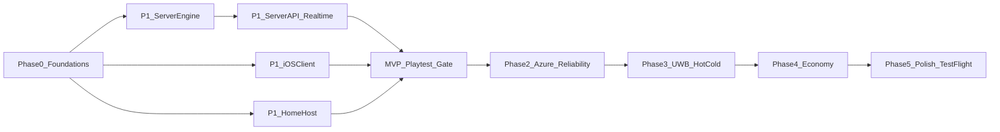

# Manhunt v1 Implementation Roadmap

> **For agentic workers:** REQUIRED SUB-SKILL: Use superpowers:subagent-driven-development (recommended) or superpowers:executing-plans. This is the master roadmap. Each phase gets its own detailed TDD plan in `docs/superpowers/plans/` with full code, written just before that phase starts. Every detailed plan MUST copy "Global Constraints" and "Contracts" verbatim. Workers never invent names that are not in Contracts.

**Goal:** Ship the Manhunt iOS game from [docs/superpowers/specs/2026-11-08-manhunt-app-design.md](docs/superpowers/specs/2026-11-08-manhunt-app-design.md), starting with an MVP that friends can play outdoors.

**Architecture:** The FastAPI server is authoritative. Each game runs as an in-memory `GameSession` built from rule modules and ticked once per second. The iOS app is a thin client: it posts actions over REST, streams location over a WebSocket, and renders a per-player `PlayerView` that the server filters. Postgres stores accounts, arenas, games, and an append-only event log. **MVP hosts the server on a home machine** via Docker Compose, reached through a tunnel (Cloudflare Tunnel recommended). Azure Container Apps, Key Vault, and Sign in with Apple move to Phase 2.

**Tech stack:** Python 3.12+ (FastAPI, Pydantic v2, SQLAlchemy 2 async with psycopg 3, Alembic, Shapely 2, PyJWT[crypto], pytest, ruff). Swift 5 mode, SwiftUI with Observation, iOS 18, no third-party packages. Azure Bicep and GitHub Actions.

---

## Decisions to confirm (defaults chosen, veto before execution)

1. **No offline rules engine on iOS.** Delete `ios/ManhuntTests/PreviewMatchTests.swift`. Port each scenario to server pytest in the phase that builds that rule (mapping below). Keep `GameRulesTests.swift` unchanged; those are cheap client helpers for editor validation and UI. Rewrite `AppStoreTests.swift` as async tests against a `FakeGameService`. Reason: the spec makes the server authoritative, and two engines would drift. Trade-off: no single-device offline play. `FakeGameService` still drives UI development and screenshots.
2. **The MVP syncs by snapshot.** The server pushes a full filtered `PlayerView` whenever something changes, and a reconnect simply gets a fresh snapshot. Replaying missed events by sequence number moves to Phase 2. Trade-off: a few more bytes per update in exchange for a much simpler client.
3. **No PostGIS in v1.** Geometry is stored as JSONB (the shape is under Contracts), validated with Shapely and checked in memory. No spatial queries exist yet; add PostGIS when one does.
4. **Precise location is never persisted in the MVP.** Phase 2 adds field-level AES-GCM encryption (key in Key Vault), the 7-day purge, and access logging. Until then, events flagged sensitive are kept in memory only. This satisfies the field-level PII encryption rule.
5. **`POST /v1/auth/dev` is the MVP sign-in.** Allowed when `MANHUNT_ENV` is in `{local,test,home}` and `MANHUNT_DEV_AUTH=true`. The server refuses to start if `MANHUNT_DEV_AUTH` is true in `{azure,prod}`. Sign in with Apple is Phase 2 (needs the paid Apple Developer Program).
6. **QR is the MVP tag method; UWB comes in Phase 3.** QR tags also require a GPS pairing check (distance no more than 30 m plus the reported accuracy).
7. **Out-of-bounds is role-specific.** Hiders: warning → countdown → `auto_tag` (eliminated). Seekers: as soon as they are confidently outside, their **exact location is shown to every player** until they return inside. Seekers are not auto-tagged. The warning/countdown banner still tells them to get back.
8. **Session tokens are 24-hour JWTs in the MVP.** Rotating refresh tokens come in Phase 2.
9. **MVP is self-hosted + sideloaded.** Docker Compose on a home machine; iOS apps installed from Xcode onto friends' phones. Azure, TestFlight, APNs, and Sign in with Apple are Phase 2+.
10. **Git:** approving this plan authorizes per-task commits and pushes to `cursor/<name>-2a9d` branches only. No merges, PRs, or deploys without Scott's explicit go-ahead.

## Human prerequisites

Phase 1 (home MVP) needs none of the paid cloud/Apple setup. You do need:

- A Mac that stays awake for the length of a game (`caffeinate` or Energy Saver "prevent sleep").
- Docker Desktop running Compose (Postgres + API).
- A way for phones on cellular to reach that Mac. **Cloudflare Tunnel (free)** is the default: HTTPS URL, no router ports, friends install nothing extra. Tailscale is the private alternative (every phone needs the Tailscale app).
- Each friend's iPhone, physically once, to sideload from Xcode. A **free Apple ID works** but the app expires after **7 days** and you reinstall. The **$99 Apple Developer Program** stretches that to a year and is required later for Sign in with Apple, APNs, and TestFlight. Get it before the second or third game night, not before writing code.

Phase 2 (Azure) needs: Azure subscription, a resource group, GitHub OIDC, and the paid Apple team with Sign in with Apple on `app.manhunt.ios`.

Phase 3 needs: two iPhone 11 or newer in the same place.

## Global Constraints

- Server: `requires-python >=3.12`, Docker image `python:3.13-slim`. If a wheel fails to install on local Python 3.14, run the tests through `docker compose run --rm server-test` instead.
- iOS: `IPHONEOS_DEPLOYMENT_TARGET = 18.0`, `SWIFT_VERSION = 5.0`, no Swift packages. Files under `ios/Manhunt/` and `ios/ManhuntTests/` are picked up automatically (synchronized folders). Never add file references to `project.pbxproj`. Only edit build settings there, and only when a task says so.
- **Engine purity:** nothing in `server/app/engine/` imports FastAPI, asyncio, the database, `datetime.now`, or the global `random`. Time comes from `Clock`, randomness from `random.Random(seed)`. All rule timers count **game seconds** (`state.game_elapsed_s`), which do not advance while paused.
- **Visibility:** every outbound state goes through `engine/views.py::build_view(session, viewer_id)`. Seekers never receive a hider's precise location except under the signal-loss safety override or after the game ends. A decoy flag is never sent to seekers. **A seeker who is confidently out of bounds is shown exactly to every player until they re-enter.**
- Readings with `accuracy_m > 30` are for display only. Zone and range decisions ignore them.
- Distances use the flat approximation at **111,320 m per degree** with longitude scaled by `cos(lat0)`, never haversine (the Swift test expects 111.32 m and haversine gives 111.19 m). Polygon containment includes the boundary (Shapely `covers`).
- Error codes come only from the `ErrorCode` list under Contracts, mirrored exactly in Swift.
- No secrets in the repo. Settings come from environment variables; Azure injects Key Vault references through a managed identity. Commit `server/.env.example` with placeholders.
- Logging uses standard `logging`, JSON in Azure, and includes `game_id`/`player_id`. Never log coordinates or tokens.
- Code style (Scott's rules): comment non-obvious logic, mark unfinished work with `TODO:`, raise specific exception types, never swallow errors.
- TDD: write the failing test first; each task ends green and committed.

## Repo layout (target)

```
server/
  pyproject.toml  Dockerfile  .env.example  alembic.ini
  app/
    main.py config.py logging_setup.py errors.py
    engine/  geo.py arena.py clock.py state.py events.py session.py views.py qr.py
             modules/ base.py roles.py head_start.py zone_policy.py reveal_fuzzy.py
                      signal_loss.py tag_policy.py win.py   (later: hot_cold.py points.py power_ups.py effects.py)
    auth/    apple.py tokens.py deps.py routes.py   (apple.py is a stub until Phase 2)
    db/      base.py models.py session.py migrations/
    arenas/  schemas.py routes.py
    presets/ classic.py routes.py
    games/   schemas.py service.py routes.py join_code.py
    realtime/ protocol.py manager.py ws.py ratelimit.py
  tests/  engine/ api/ sim/ (bot harness)  conftest.py
docker-compose.yml          (db: postgres:16, server, server-test)
infra/  main.bicep  modules/*.bicep  env/dev.bicepparam env/prod.bicepparam
.github/workflows/ ci.yml deploy.yml
ios/Manhunt/
  Domain/     GeoPoint.swift Arena.swift ArenaGeometry.swift ArenaValidator.swift JoinCode.swift
              SplitMix64.swift BoundsMachine.swift RoleAssigner.swift PowerUpRules.swift ErrorCode.swift
  Editor/     ArenaEditorModel.swift
  Networking/ DTOs.swift APIClient.swift GameSocket.swift GameService.swift LiveGameService.swift FakeGameService.swift
  Auth/       KeychainStore.swift AppleSignIn.swift
  Location/   LocationReporter.swift
  Store/      AppStore.swift
  Views/      (existing screens moved here, rewired from VisualStore to AppStore)
```

## Contracts (lock before coding)

### Engine module interface (Python)

```python
class BaseModule:                      # engine/modules/base.py; subclasses override only what they need
    module_id: ClassVar[str]
    def __init__(self, settings: dict[str, Any]) -> None: self.settings = settings
    def on_start(self, s: "GameSession") -> None: ...
    def on_tick(self, s: "GameSession") -> None: ...                   # called after game time advances
    def on_location(self, s: "GameSession", p: PlayerState, r: LocationReading) -> None: ...
    def check_tag(self, s: "GameSession", claim: TagClaim) -> ErrorCode | None: ...  # return a code to veto
    def on_event(self, s: "GameSession", e: GameEvent) -> None: ...
    def check_win(self, s: "GameSession") -> WinResult | None: ...

class GameSession:                      # engine/session.py
    def __init__(self, game_id: UUID, arena: Arena, preset: PresetSnapshot, clock: Clock, seed: int): ...
    state: GameState
    def add_player(self, player_id: UUID, display_name: str, is_host: bool) -> PlayerState
    def assign_roles_random(self, hider_count: int) -> None
    def set_role(self, player_id: UUID, role: Role) -> None
    def start(self) -> None                      # raises GameRuleError(ErrorCode.NEED_BOTH_ROLES)
    def pause(self) -> None; def resume(self) -> None; def end(self, reason: str) -> None
    def record_location(self, player_id: UUID, reading: LocationReading) -> None
    def claim_tag(self, claim: TagClaim) -> None # raises GameRuleError(code)
    def tick(self) -> None                       # reads clock.now(), advances game time unless paused
    def emit(self, type: EventType, payload: dict, *, player_id: UUID | None = None,
             tone: Tone = "info", sensitive: bool = False) -> GameEvent
    def drain_events(self) -> list[GameEvent]
```

Phases: `lobby -> head_start -> active -> ended`, plus `paused` reachable from `head_start` or `active`. Enums use the snake_case strings shown in the WebSocket section.

### REST (prefix `/v1`; error body `{"error":{"code","message","details"}}`)

- `POST /auth/apple {identity_token, display_name?}` and `POST /auth/dev {display_name}` both return `{access_token, expires_at, user}`
- `GET /me`
- `GET|POST /arenas`, `GET|PUT|DELETE /arenas/{id}`. Invalid geometry returns 422 `ARENA_INVALID` with `details.issues`.
- `GET /presets` (MVP: only `classic`)
- `POST /games {arena_id, preset_id, overrides: {module_id: {field: number|bool|string}}}` returns `GameOut`
- `POST /games/join {join_code}`, `GET /games/{id}`, `POST /games/{id}/leave`
- Host only: `POST /games/{id}/roles {mode:"random",hider_count} | {mode:"manual",assignments:{player_id:role}}`, `POST /games/{id}/start|pause|resume|end`
- `POST /games/{id}/tags/qr {token}` returns `{result:"accepted"}` or 409 with an error code
- `GET /healthz`, `GET /readyz`

### Arena JSON (shared by REST, Swift Codable, and the DB)

```json
{"name":"Riverside","boundary":[{"lat":40.66,"lon":-73.97}],
 "zones":[{"id":"uuid","name":"Gazebo","kind":"safe|out_of_bounds|seeker_spawn",
   "shape":{"type":"circle","center":{"lat":0,"lon":0},"radius_m":15}
        | {"type":"polygon","vertices":[{"lat":0,"lon":0}]}}]}
```

Limits: 3 to 100 vertices per polygon, at most 30 zones, lat within [-90, 90], lon within [-180, 180], circle radius between 2 and 500 m.

### WebSocket `/v1/games/{id}/ws` (envelope `{"type":str,"data":{}}`)

- Client to server: `hello {token, last_seq|null}` must arrive within 5 s or the server closes with 4401. Then `location {lat, lon, accuracy_m, recorded_at, battery|null, flag:"normal|low_battery|final"}` and `ping {}`.
- Server to client: `welcome {player_id, server_time}`, `view {PlayerView}` (sent on change, at most every 500 ms, at least every 5 s), `event {seq, type, text, tone:"info|warning|safety|success", at, player_id|null}`, `qr_token {token, expires_at}` (hiders only, rotates every 30 s), `error {code, message}`, `pong {}`.
- Close codes: 4401 unauthorized, 4403 not a member, 4404 no game, 4429 rate limited. The client pings every 15 s to stay under the Container Apps idle timeout.

```json
PlayerView {"game_id","join_code","phase","phase_remaining_s","game_elapsed_s","time_limit_remaining_s",
 "you":{"player_id","role":"hider|seeker|unassigned","status":"active|eliminated|signal_lost","is_host",
        "bounds":{"phase":"inside|warning|countdown|penalized","remaining_s"},"safe_zone":{"zone_id","remaining_s"}|null,"points"},
 "players":[{"player_id","display_name","role","status","is_host",
             "location":{"lat","lon","accuracy_m","at","kind":"exact|last_known"}|null}],
 "reveals":[{"reveal_id","player_id","lat","lon","radius_m","expires_in_s"}],
 "banners":[{"banner_id","tone","title","detail","player_id"}],
 "result":{"winner":"hiders|seekers|none","reason","ended_at"}|null}
```

Who can see a player's location in `view` (MVP):

- You always see yourself exactly.
- You see same-role teammates exactly.
- You never see opponents, with these exceptions:
  - a `signal_lost` player's last known location goes to everyone (safety);
  - after `ended`, everyone's last location goes to everyone;
  - a **seeker** whose bounds phase is not `inside` is shown exactly to every player (`kind: "exact"`) until they re-enter. Hiders who are out of bounds are **not** revealed this way; they are on the auto-tag path instead.
- Seekers get fuzzed `reveals` (a random offset within `fuzz`; the circle radius equals `fuzz`, so the true position is always inside the circle). Hiders see only their own reveal circle, plus any out-of-bounds seekers above.
- No locations in the lobby.

### ErrorCode (identical strings on the server and in Swift `ErrorCode: String, Codable`)

`UNAUTHORIZED FORBIDDEN NOT_HOST NOT_A_MEMBER VALIDATION_FAILED ARENA_INVALID ARENA_NOT_FOUND PRESET_NOT_FOUND GAME_NOT_FOUND INVALID_JOIN_CODE GAME_FULL WRONG_PHASE NEED_BOTH_ROLES TOKEN_INVALID TOKEN_EXPIRED NOT_IN_PAIRING_RANGE NOT_IN_RANGE TARGET_NOT_ACTIVE TARGET_SHIELDED TARGET_IN_SAFE_ZONE WRONG_ROLE ELIMINATED INSUFFICIENT_POINTS COOLING_DOWN NEEDS_TARGET TARGET_OUTSIDE RATE_LIMITED INTERNAL`

HTTP status: 401 or 403 for auth, 404 for missing objects, 409 for rule violations, 422 for validation, 429 for rate limits.

### Classic preset (module ids and defaults; Swift tests already use these ids)

- `roles`: mode `random|manual` (default `random`), `hider_count` 1 to 20 (default 2)
- `head_start`: enabled, `duration` 15 to 600 s (default 60), `seeker_lock` `locked_map|spawn_zone` (default `locked_map`; `spawn_zone` arrives in Phase 3)
- `reveal_fuzzy`: enabled, `interval` 20 to 600 s (default 60), `display` 5 to 60 s (default 10), `fuzz` 0 to 100 m (default 30)
- `tag_policy`: method `qr` (`uwb` arrives in Phase 3), `radius_m` 1 to 5 (default 2), `result` `eliminate|convert` (default `eliminate`), `pairing_m` default 30
- `zone_policy`: `margin_m` default 5, `oob_countdown` 5 to 120 s (default 15), `hider_oob_penalty` `auto_tag` (MVP; `forced_reveal` stays in the enum for later), `seeker_oob_penalty` `forced_reveal` (MVP: reveal for the whole time they are outside, no auto-tag), `safe_visit` default 60 s, `safe_cooldown` default 60 s
- `signal_loss`: `silence` 15 to 300 s (default 45), `penalty_after` default 180 s, `penalty` `none|eliminate` (default `none`; applied in Phase 2)
- `win`: condition `all_caught|time_limit|either` (default `either`), `time_limit` 5 to 180 min (default 30)

Overrides are validated against these ranges (422 `VALIDATION_FAILED`). Formal versioned schemas arrive in Phase 5.

### Swift domain API (already pinned by `GameRulesTests.swift`; do not rename)

`GeoPoint(latitude:longitude:)` (Codable keys `lat`/`lon`), `Polygon(vertices:)`, `Arena(id:name:boundary:zones:)`, `ArenaZone(id:name:kind:shape:)`, `ZoneKind {safe, outOfBounds, seekerSpawn}`, `ZoneShape {polygon(Polygon), circle(center:radiusMeters:)}`, `ArenaGeometry.meters/contains/isConfidentlyOutside`, `ArenaValidator.issues(in:) -> [ArenaIssue]` with `ArenaIssue {selfIntersection(String), playAreaTooSmall, outsidePlayArea(String)}`, `JoinCode.normalize/isValid/generate(using:)` (alphabet `ABCDEFGHJKMNPQRSTUVWXYZ23456789`, also used by the server), `SplitMix64(state:)` conforming to `RandomNumberGenerator`, `BoundsMachine` with `phase: BoundsPhase {inside, warning, countdown(remainingSeconds:), penalized}`, `RoleAssigner.assign(playerIDs:hiderCount:using:) -> [UUID: PlayerRole]`, `PlayerRole {hider, seeker, unassigned}`, `PowerUpRules.decide(PurchaseRequest) -> PurchaseDecision`, `MatchPhase`, `PlayerStatus {active, eliminated, signalLost}`. `ArenaEditorModel` is `@Observable final class` and **not** `@MainActor` (the tests call it from a nonisolated context), and its tool enum is `EditorTool {playArea, safeCircle, outOfBounds, seekerSpawn}`. The name `ArenaTool` is already taken in `VisualModels.swift`.

## Phases



The iOS lane runs in parallel with the server lanes because it builds against `FakeGameService` and the Contracts above.

### Phase 0: Foundations

- **0.1 Server scaffold.** `pyproject.toml` (deps listed in Tech stack, plus `[dev]` extras), `app/main.py` exposing `GET /healthz`, `app/config.py` (pydantic-settings: `MANHUNT_ENV` in `{local,test,home,azure,prod}`, `MANHUNT_DATABASE_URL`, `MANHUNT_SESSION_SIGNING_KEY`, `MANHUNT_QR_SIGNING_KEY`, `MANHUNT_APPLE_AUDIENCE`, `MANHUNT_DEV_AUTH`, `MANHUNT_TICK_LOOP`), the startup guard that refuses `MANHUNT_DEV_AUTH=true` when env is `azure` or `prod`, `errors.py` (ErrorCode, `ApiError`, `GameRuleError`, handlers), `.env.example`, `Dockerfile`, and root `docker-compose.yml` (postgres:16 + server). Gate: `pytest -q` passes the health and dev-auth-guard tests, and `ruff check` is clean.
- **0.2 iOS domain core.** Implement everything under `Domain/` plus `Editor/ArenaEditorModel.swift` until `GameRulesTests` passes. Delete `PreviewMatchTests.swift` and temporarily delete `AppStoreTests.swift` (Task 1.16 rewrites it). Gate: `xcodebuild test` (command in the Worker playbook) is green.
- **0.3 CI.** `.github/workflows/ci.yml` runs server ruff and pytest against a postgres service container, and the iOS `xcodebuild test` on `macos-15`. Tests only, no deploy. Bicep CI waits until Phase 2.

### Phase 1: MVP, first playable game outdoors

Engine lane (pure Python, `tests/engine/`; FakeClock plus a `run_for(session, clock, seconds)` helper that ticks once per second):

- **1.1 `geo.py` and `arena.py`:** projection, distance, `covers`, `is_confidently_outside`, and `validate_arena -> list[ArenaIssue]`. Port the geometry, validator, and out-of-bounds-accuracy tests from `GameRulesTests.swift` with identical numbers.
- **1.2 `state.py`, `clock.py`, `events.py`, `session.py`, `head_start.py`:** phase machine, game time, pause. Ports the Swift tests `HeadStartHonorsTheEditedDuration`, `PauseFreezesTheHeadStartClock`, and `DisabledHeadStart...CannotStartWithoutBothRoles`.
- **1.3 `roles.py`:** random (clamped like `RoleAssigner`) and manual assignment.
- **1.4 `zone_policy.py`:** a per-player `BoundsMachine` evaluated once per tick (Swift semantics: first outside tick is warning, next is countdown(N), then it decrements, then penalized), plus the safe-zone visit timer and cooldown. Hiders who reach `penalized` are auto-tagged. Seekers who are not `inside` are marked `oob_revealed` (no auto-tag). Ports `OutOfBoundsCountdownEliminatesAHider`, the `BoundsMachine` test, and a new test `test_seeker_outside_is_revealed_until_they_return`.
- **1.5 `reveal_fuzzy.py`:** interval and display timers, seeded fuzz offset.
- **1.6 `signal_loss.py`:** silence detection, a safety banner for everyone, and a `last_known` override. Ports `SilenceShowsTheLastPreciseLocation`.
- **1.7 `qr.py`, `tag_policy.py`, `win.py`:** HMAC-SHA256 token `b64url(json{g,h,exp}).b64url(sig)` that rotates every 30 s; QR claim checks (signature, expiry, game, roles, active status, GPS pairing, safe zone); eliminate or convert; win conditions. Ports `AFarGpsPairCannotBeSaved` as `NOT_IN_PAIRING_RANGE`.
- **1.8 `views.py`:** implements the visibility rules from Contracts, including seeker out-of-bounds pins on every view. Test every role and phase combination, plus "seeker leaves / re-enters." This is the anti-cheat boundary, so its tests must be thorough.

API and realtime lane:

- **1.9 DB:** SQLAlchemy models `users(id, apple_sub unique null, dev_handle unique null, display_name, created_at)`, `arenas(id, owner_id, name, data jsonb, version, timestamps)`, `games(id, join_code, host_id, status, arena_snapshot, preset_snapshot, seed, created_at, started_at, ended_at, result jsonb)` with a partial unique index on `join_code` for non-ended games, `game_players(game_id, user_id, role, status, joined_at)`, and `game_events(game_id, seq, type, payload, created_at, PK(game_id, seq))`. Alembic initial migration. On startup, mark games left in `head_start`, `active`, or `paused` as `abandoned` (`TODO:` Phase 2 replays them instead).
- **1.10 Auth:** 24-hour HS256 session JWT, `current_user` dependency, and `POST /auth/dev {display_name}` (creates or reuses `users.dev_handle`). `auth/apple.py` is a stub that 501s until Phase 2. Tests cover the env guard (dev auth refused in `prod`).
- **1.11 Arenas and presets REST:** owner-scoped CRUD, validation through `engine/arena.py`, `presets/classic.py` holding the settings above, override validation.
- **1.12 Games REST:** create (snapshots the arena and preset), join (10 attempts per minute per user to stop brute-forcing join codes), roles, start, pause, resume, end, leave, QR tag. 20-player cap. Authorization checks membership, host status, and phase.
- **1.13 Realtime:** `SessionManager` maps game id to a running game, with one asyncio tick loop at 1 s (disabled when `MANHUNT_TICK_LOOP=false`). The WebSocket hello/auth handshake, location rate limit of 2 per second (excess dropped), fan-out of filtered views and events, QR token push to hiders, and async writes of non-sensitive events to `game_events`. Engine calls are synchronous and run on the event loop only, so no locks are needed.
- **1.14 Bot simulation (primary integration test, `tests/sim/`):** starlette `TestClient` with several WebSockets, FakeClock, and manual `manager.tick_all()`. Scenario A: three bots, head start, a seeker scans the hider's pushed QR token, seekers win. Scenario B: a hider leaves the play area and is eliminated by the countdown. Scenario C: a hider goes silent and every bot gets a safety banner. Scenario D: a seeker leaves the play area; every hider view contains that seeker's exact location; after they re-enter, it is gone. Assert that no seeker view ever contains a **hider's** exact location (seeker OOB pins are the exception that runs the other way).

iOS lane:

- **1.15 Networking:** `DTOs.swift` (PlayerView and friends, snake_case decoding, `ErrorCode`), `APIClient` (async throws `ServiceError`), `GameSocket` (`URLSessionWebSocketTask`, hello, 15 s ping, reconnect with backoff 1/2/4/8/15 s plus jitter, **60 s timeout on the first connect so a waking host is survivable later**), the `GameService` protocol, `LiveGameService`, and `FakeGameService` (seeded from `SamplePark`; join code `PARK42`). Add `ManhuntAPIBaseURL` to Info.plist from build setting `MANHUNT_API_BASE_URL` (Debug default `http://localhost:8000`). `NSAppTransportSecurity.NSAllowsLocalNetworking = true`. For the home tunnel, the sign-in screen stores a server URL in `UserDefaults` (https Cloudflare URL). If the URL is `http://` and not loopback, also set `NSAllowsArbitraryLoads` in Debug only.
- **1.16 `AppStore`:** `@MainActor @Observable`, with async methods and `screen` in `{signedOut, home, arenaEditor, createGame, lobby, live, results}`. Rewrite `AppStoreTests.swift` against `FakeGameService`, keeping every original scenario: unknown arena gives a missing-arena error, start before roles gives `NEED_BOTH_ROLES`, a malformed join code is rejected client-side without a network call, `ABCDEF` gives `GAME_NOT_FOUND`, `park42` joins as a non-host, and sign-out drops the match. Switch `RootView` and `ManhuntApp` to `AppStore`. Keep the `MANHUNT_SCREEN` screenshot launches working through the fake.
- **1.17 Auth UI:** display-name field, optional **Server URL** field (pre-filled from Info.plist, persisted in `UserDefaults`), and a Play button that calls `/auth/dev`. `KeychainStore` holds the session token. No Sign in with Apple button in MVP. Show a clear error if the host is unreachable, including "Is the home server running?"
- **1.18 Arena editor:** wire `ArenaEditorView` to `ArenaEditorModel`, show validator issues inline, save through the API.
- **1.19 Create game and lobby:** pick an arena, the Classic preset, and a few overrides (head start, reveal interval, out-of-bounds countdown, time limit). The lobby is driven by WebSocket views, with randomize, manual role cycling, and start.
- **1.20 `LocationReporter`:** `CLLocationUpdate.liveUpdates()` plus `CLBackgroundActivitySession` during a game. Send at most every 2.5 s or every 3 m moved. Show blocking screens when permission is denied or `accuracyAuthorization != .fullAccuracy`, with a link to Settings. Never request Always authorization.
- **1.21 Live game:** `HuntMap` renders `PlayerView` (positions, reveal circles, zones), plus banners for out-of-bounds, safe-zone time, and safety alerts, the head-start overlay, a reconnecting banner, haptics on warnings, and host pause/resume/end. Remove the preview-only "eye" menu.
- **1.22 QR:** hiders render `qr_token` with `CIFilter.qrCodeGenerator()`. Seekers scan with VisionKit `DataScannerViewController` and post `/tags/qr`; DEBUG builds can paste a token for the simulator. Map rejection codes to user-facing text.
- **1.23 Results:** winner, reason, and player list from `view.result`. Delete the leftover `VisualStore` and sample-only types.

Home-host lane (replaces Azure for MVP):

- **1.24 Home runbook, not a cloud deploy.** Compose file already from 0.1. Add `cloudflared` as an optional profile (`docker compose --profile tunnel up`) using `TUNNEL_TOKEN` from the environment, never committed. Document in `README.md`: `docker compose up`, copy the `https://….trycloudflare.com` (quick tunnel) or named-tunnel URL into the iOS Server URL field, `caffeinate -dims` on the Mac, sideload steps (Xcode → each iPhone, trust the developer cert on the phone). Gate: `curl https://<tunnel>/v1/healthz` returns 200 from a phone on cellular, and a sideloaded Debug build can sign in.

**MVP exit gate (human):** GPX-route simulator run (`ios/Support/GPX/*.gpx`), then three sideloaded phones play a full game in a park against the home server: join, head start, a reveal, a hider out-of-bounds elimination, a seeker out-of-bounds pin visible to hiders, a QR tag, and a going-dark alert.

### Phase 2: Azure, Sign in with Apple, reliability

Move the "real" hosting and identity here. Crash recovery is a prerequisite for scale-to-zero, because a replica that goes to 0 currently forgets in-memory games.

- 2.0 **Azure Bicep + scale-to-zero** (see cost section below). Container Apps consumption, `minReplicas: 0`, `maxReplicas: 1`. Postgres Flexible B1ms **stays running** (stopping it misses the ~1 minute wake budget). Image from GHCR to skip the $5 ACR. Key Vault for JWT/QR/Apple keys. `deploy.yml` on `workflow_dispatch`, `prod` environment requires reviewers. iOS shows "Waking the hunt server…" and retries for up to 60 s on the first request. The process must not scale to 0 while any game is in `lobby`, `head_start`, `active`, or `paused` (WebSocket + 15 s pings keep HTTP concurrency above zero; cooldown 300 s after the last game ends).
- 2.1 Sign in with Apple (paid team, `aud=app.manhunt.ios`). Dev auth stays off in `azure`/`prod`.
- 2.2 Per-game event `seq`. The client sends `last_seq`; the server replays missed events or sends a snapshot.
- 2.3 Field-level AES-256-GCM for sensitive event payloads (key id plus Key Vault key), persisted location trail, a daily purge job (7 days, host-adjustable), and an audit log of every trail read.
- 2.4 Crash recovery: on startup, rebuild active sessions by replaying the inputs in the event log through the deterministic engine (seed plus logged clock times). **Do not ship scale-to-zero to a shared environment until this works.**
- 2.5 Signal-loss penalty threshold, host acknowledgment of safety alerts, low-battery ping at 5%, and a best-effort final ping.
- 2.6 Host removes a player, host undoes a tag (logged).
- 2.7 Rotating refresh tokens (stored hashed). 2.8 APNs for "game starting" and invites. 2.9 App Insights with a 1 GB/day cap, `/readyz` reports active games so deploys wait until none are running.

## Azure cost options (Phase 2, not MVP)

List prices, **East US, USD, excluding tax**, checked 9 Nov 2026. A friends group playing a few hours a month. Sources: [Container Apps pricing](https://azure.microsoft.com/en-us/pricing/details/container-apps/), [PostgreSQL Flexible Server](https://azure.microsoft.com/en-us/pricing/details/postgresql/flexible-server/) (~$12.41/mo B1ms compute), [ACR](https://azure.microsoft.com/en-us/pricing/details/container-registry/) (~$5.01/mo Basic), Log Analytics ~$2.30/GB, Key Vault ~$0.03/10k ops.

Consumption plan free grant per subscription per month: 180,000 vCPU-seconds (~50 vCPU-hours), 360,000 GiB-seconds (~100 GiB-hours), 2 million requests. A 0.5 vCPU / 1 GiB replica playing 8 hours/month sits inside that grant, so **app compute is ~$0** for this usage.

| Option | Idle (no games) | Play night (2h, 0.5 vCPU / 1 GiB) | Wake time | Verdict |
|---|---|---|---|---|
| **A. Home host (MVP, keep as long as you want)** | $0 cloud | electricity | instant if Compose is up | Default until you are tired of the Mac |
| **B. ACA scale-to-zero + B1ms Postgres always on + GHCR (no ACR) + log cap** | **~$16–18/mo** (Postgres $12.41 compute + ~$4 for 32 GB storage; Key Vault pennies; logs near $0) | +~$0 (inside free grant) | **10–40 s** typical container cold start; budget 60 s in the client | **Recommended for Phase 2.** Hits the "wait a minute" budget. Postgres is ~80% of the bill and cannot autoscale to zero in a minute. |
| **C. Same as B but keep 1 replica always on** | ~$28–32/mo (B plus ~$12 idle replica: idle vCPU $0.0108/vCPU-hour + memory $0.0108/GiB-hour) | ~$0 extra | none | Only if cold start annoys people. Savings of B vs C are real but small (~$12/mo). |
| **D. Stop Postgres when idle, plus scale-to-zero app** | **~$4–6/mo** (storage only while compute is stopped) | + B1ms hourly for the evening | **3–10+ min** (Flexible Server start), then container. Azure **auto-restarts a stopped server after 7 days**. | Skip. You said ~1 minute is okay; this is not 1 minute, and the extra $12/mo is not worth the ops. |
| **E. Original spec: 1 replica + B1ms + ACR Basic + App Insights uncapped** | **~$35–50/mo** (C + $5 ACR + log surprise) | same | none | Do not build this. Pull images from GHCR; cap logs; scale the app to zero. |

**Do not stop the database to save money.** Flexible Server stop/start is a manual (or timer) operation, start is minutes, and Azure brings it back after a week. The honest scale-to-zero design is: **app replicas = 0 when no lobbies; database stays on.**

Scale-to-zero only after Phase 2 crash recovery. Until then a replica that dies mid-game loses the in-memory `GameSession`. Home hosting avoids that by simply not sleeping the Mac during a hunt.

**What "spin up when someone creates a game" actually is on ACA:** the first `POST /games` (or `/auth/apple`) is an HTTP request. KEDA starts a replica, the request waits, then succeeds. There is no separate "create lobby" control plane. After the last WebSocket disconnects and the 300 s cooldown, replicas go to 0. If KEDA ever treats a quiet WebSocket as idle, the server will also HTTP-ping itself every 15 s while `SessionManager` has a non-ended game (`TODO:` verify on a real ACA environment in 2.0).

### Phase 3: UWB tagging and hints

- 3.1 Relay Nearby Interaction discovery tokens when GPS distance is no more than 30 m, keeping sessions only with each player's closest opponents. `TODO:` verify the concurrent-session limit on the current iOS release and record it in the code.
- 3.2 Two-sided range claims (both ranges must be within `radius_m`). Ports `TagRequiresBothRanges` as `NOT_IN_RANGE`.
- 3.3 `hot_cold.py` (distance band and bearing, update frequency) and the iOS hint dock. 3.4 `seeker_lock=spawn_zone`.

### Phase 4: Points economy and power-ups

- 4.1 `effects.py` (owner, target, type, expiry in game time).
- 4.2 `points.py`: close call, survival, taunt (scaled by distance to the nearest seeker), others tagged, tag (+25). Ports `CloseTauntScoresMoreThanADistantOne` and the seeker going from 100 to 125 points.
- 4.3 Server purchase pipeline mirroring `PowerUpRules`. Ports `SecondShieldPurchaseIsOnCooldown`.
- 4.4 Hider power-ups: Ghost, Decoy, Radar, Jammer, Shield. Ports `Ghost...Decoy`, `DecoyOutsideThePlayArea`, and `ShieldAndSafeZonesBlockTagsUntilLockdown`.
- 4.5 Seeker power-ups: Scan, Tracker, Lockdown. Ports `ScanRadarAndJammer...`.
- 4.6 iOS dock with the points balance, power-up chips (greyed out using `PowerUpRules`), a decoy target picker, and radar pins.

### Phase 5: Polish and TestFlight

- 5.1 Versioned settings schemas per module, `GET /v1/modules`, and migration of older settings versions. 5.2 Schema-driven preset editor plus a `rule_presets` table for saved presets.
- 5.3 Full arena editor (drag vertices, rename, delete). 5.4 Results timeline built from the event log. 5.5 Invite link and QR join (universal link).
- 5.6 TestFlight archive and upload workflow (replaces weekly Xcode sideload; a human holds the signing credentials).

## Worker playbook

- Server: `cd server && python3 -m venv .venv && . .venv/bin/activate && pip install -e '.[dev]' && docker compose up -d db && pytest -q && ruff check .`
- iOS: `cd ios && xcodebuild test -project Manhunt.xcodeproj -scheme Manhunt -destination 'platform=iOS Simulator,name=iPhone 16 Pro,OS=18.4'`
- Done means: the new tests failed first and now pass, the whole suite is green, there are no new warnings, the commit is on your task branch, and anything unfinished is marked with a `TODO:` comment.
- Pitfalls: never call `datetime.now()` or `random` in the engine. Never send unfiltered state. Do not make `ArenaEditorModel` `@MainActor`. Never use haversine. Keep `is_decoy` off the wire. Do not edit `project.pbxproj` file lists. Do not write coordinates to logs or (before Phase 2) to the database.

## Execution handoff

After approval: (1) save this roadmap to `docs/superpowers/plans/2026-11-09-manhunt-roadmap.md`; (2) write the detailed TDD plans with full code: `...-phase0-foundations.md`, `...-phase1-engine.md`, `...-phase1-api-realtime.md`, `...-phase1-ios.md`, `...-phase1-home-host.md`; (3) run them with subagent-driven development. Phases 2 through 5 get their detailed plans only after the previous phase merges, so their code matches what actually exists.