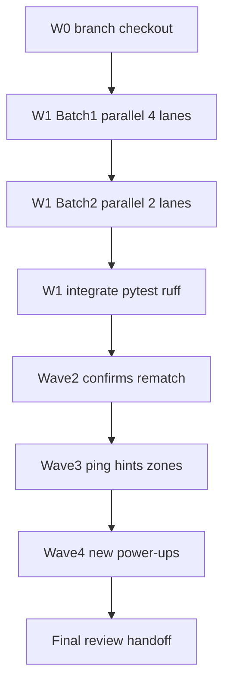

---
todos:
  - id: w0-branch
    status: in_progress
    content: 'Orchestrator: checkout cursor/playtest-wave1-2a9d; copy plan to docs/superpowers/plans/'
  - id: w1-batch1
    content: 'Wave1 Batch1 parallel: persist race | spawn+reveals | map dupes | SF symbols+README'
    status: pending
  - id: w1-batch2
    content: 'Wave1 Batch2 parallel: kick UX | AppStore rename+hiccup'
    status: pending
  - id: w1-integrate
    content: 'Wave1 integrate: pytest+ruff; iOS tests if simulator; task reviews; fix Critical'
    status: pending
  - id: w2-confirms-rematch
    content: 'Wave2: home/sign-out confirms + rematch to lobby'
    status: pending
  - id: w3-ping-hints-zones
    content: 'Wave3: ping sound/flashlight toggles, hot/cold UX, tracker rules, spawn hide, lockdown fade, scan/safe-zone settings'
    status: pending
  - id: w4-powerups
    content: 'Wave4: untag/immunity, move/create safe zone, shrink-now + SF Symbols'
    status: pending
  - id: final-review
    content: Final whole-branch review + morning handoff note (no PR unless asked)
    status: pending
name: Playtest Overnight Build
overview: 'Overnight autonomous build via subagent-driven development: parallel Wave 1 lanes, then queued Waves 2–4 until everything in this chat is implemented on `cursor/playtest-wave1-2a9d`. No PR/merge/deploy. No human check-ins between tasks.'
isProject: false
---
# Playtest Overnight Build

> **For agentic workers:** REQUIRED SUB-SKILL: `superpowers:subagent-driven-development`. Fresh implementer subagent per task; task review after each; no pausing for human check-ins. Continuous execution until Waves 1–4 are done or truly BLOCKED.

**Goal:** Everything requested in this chat lands on branch `cursor/playtest-wave1-2a9d` by morning — Wave 1 reliability/UX first (parallel), then Waves 2–4 queued.

**Architecture:** Orchestrator in this session dispatches parallel implementer subagents for independent lanes, serializes file-conflict lanes, reviews, then advances waves. Commits on the feature branch are authorized by this overnight build; **do not** push, open a PR, merge, or deploy unless Scott asks.

**Tech stack:** FastAPI/Postgres game server, SwiftUI iOS client, pytest + xcodebuild.

## Global Constraints

- Branch: `cursor/playtest-wave1-2a9d` (AGENTS naming). Never merge/PR/deploy unprompted.
- English code/comments; `TODO:` for unfinished; never swallow exceptions; no secrets/coords in logs.
- Distances: 111,320 m/deg; `is_decoy` never on the wire; engine no `datetime.now()` / global `random`.
- Server verify: `cd server && . .venv/bin/activate && pytest -q && ruff check .`
- iOS verify when simulator available: `xcodebuild test -project ios/Manhunt.xcodeproj -scheme Manhunt -destination 'platform=iOS Simulator,name=iPhone 16 Pro,OS=18.4'`
- Do not check off human gates in remaining-benchmarks.
- Username compliance / moderation: **skip** (needs Scott product call).
- Taunt-in-pre: **skip** unless a failing test appears (already gated to `active`).

## Overnight orchestrator protocol

1. **No check-ins.** Do not ask “continue?” — run the whole queue.
2. **Subagent-driven:** one fresh implementer per task; include exact files, acceptance, test commands; require commit message on success.
3. **Parallel where safe:** dispatch Batch 1’s four lanes in one turn (`run_in_background: false` for quality, or parallel local Tasks if the harness allows simultaneous implementers — prefer true parallel for Batch 1).
4. **After each task:** quick task-review subagent on the diff; fix Critical/Important before marking done.
5. **If BLOCKED** (no simulator, merge conflict you cannot resolve): leave a `TODO:` + morning note; continue other work.
6. **End state:** all waves committed on the branch; short morning summary of commits, test results, and anything left open.

---

## W0 — Branch (orchestrator, sequential)

- `git checkout -b cursor/playtest-wave1-2a9d` (from current HEAD; keep existing local WIP).
- Copy this plan into [`docs/superpowers/plans/2026-11-17-playtest-overnight-build.md`](docs/superpowers/plans/2026-11-17-playtest-overnight-build.md).
- Commit the plan file only if the tree is clean enough; otherwise leave untracked and continue.

---

## Wave 1 — Batch 1 (PARALLEL — dispatch 4 implementers together)

### Lane A — Event persist race + end regression
**Files:** `server/app/games/service.py`, `server/app/main.py`, `server/app/engine/session.py` (end idempotent only), new tests under `server/tests/`.

**Do:**
- Per-`game_id` `asyncio.Lock` + `last_persisted_seq`; skip `seq <= watermark`; advance watermark only after successful commit.
- `INSERT … ON CONFLICT DO NOTHING` (Postgres + SQLite).
- Move `drain_events()` to after successful persist.
- `persist_all`: per-game session commit/rollback; never leave a dirty transaction.
- `GameSession.end` idempotent when already `ended`.
- Tests: concurrent persist no UniqueViolation; end under racing tick returns 200.

### Lane B — Spawn lock harden + no head-start reveals
**Files:** `server/app/engine/modules/head_start.py`, `reveal_fuzzy.py`, `server/app/engine/state.py` / `session.py` only for `spawn_in_streak` field if needed, `server/tests/engine/`.

**Do:**
- Clock held until every active seeker is in spawn; leave → re-hold; 2 consecutive accurate in-spawn ticks required.
- `reveal_fuzzy` / hot-cold pulse only when `phase == "active"`.
- Tests for hold/release/leave/flicker and no reveals in head_start.

### Lane E — Duped map markers
**Files:** `ios/Manhunt/HuntMap.swift`, `ios/Manhunt/LiveGameView.swift`, iOS tests if present.

**Do:** Empty annotation titles (no MapKit double labels); one pin per player id (people vs reveals); dedupe spawnLock zones vs arena zones.

### Lane F — SF Symbols + README Horizon
**Files:** `ios/Manhunt/VisualModels.swift`, `ios/Manhunt/LiveGameView.swift` (dock chip UI only), `README.md`, optionally `docs/superpowers/plans/`.

**Do:**
- `PowerChip.systemImage` + dock `Image(systemName:)`; symbols: ghost `eye.slash`, decoy `person.fill.questionmark`, radar `dot.radiowaves.left.and.right`, jammer `waveform.slash`, shield `shield.fill`, scan `viewfinder`, tracker `location.magnifyingglass`, lockdown `lock.shield.fill`.
- README **Horizon** section: Capture the flag, Senior assassin, Persistent (college intermittent pings / denser near frequent places).

**Batch 1 merge note:** If A and B both touch `session.py`, land A’s end-idempotent commit first or keep B’s streak field in `PlayerState` only.

---

## Wave 1 — Batch 2 (PARALLEL after Batch 1 merges — 2 implementers)

### Lane C — Kick → home + lobby broadcast
**Files:** `server/app/games/service.py` (`remove_player` only), `ios/Manhunt/Networking/GameSocket.swift`, `ios/Manhunt/Store/AppStore.swift` (kick/removed path only), tests.

**Do:** Send `{type:"removed"}` then `4403`; `broadcast` after remove; client stops reconnect, goes home with note.

### Lane D — Rename + hiccup debounce
**Files:** `ios/Manhunt/Store/AppStore.swift` (auth/displayName + reconnect note paths), tests.

**Do:**
- Sync display name on token restore; re-auth before create/join if field ≠ session name.
- Hiccup toast only after ≥3s reconnecting or ≥2 consecutive send failures; clear on successful view/send.

---

## Wave 1 — Integrate (orchestrator)

- Run full server `pytest -q && ruff check .`.
- Run iOS tests if simulator present; else note skip.
- Dispatch task reviewers on any remaining Critical diffs; fix.
- Commit any integrate fixes. Mark Wave 1 complete.

---

## Wave 2 — Queued (after Wave 1; can split into 2 sequential subagents)

### 2a Confirmations
- Confirmation before **Home** (`goHome` / leave) and **Sign out**.
- Pattern: existing arena/preset `.alert` / host `.confirmationDialog`.

### 2b Rematch
- Results screen **Rematch**: host creates a new lobby with same rules/arena; others get a path back to lobby (invite/code or join broadcast). Prefer new game id (PARK42-after-end pattern), not mutating an ended game.
- Tests for rematch create + client navigation.

---

## Wave 3 — Queued (after Wave 2; parallelize into 2–3 subagents if files don’t collide)

### 3a Ping toggles
- Individual toggles: ping **sound**, ping **flashlight** (default off or respect prior settings).
- Wire to `PingDetector` / `PingFlashOverlay`; torch via existing `TorchController`.

### 3b Hot/cold + tracker
- Clear UI/preset copy for when hints are on/off.
- Wire `tracker_until_s` into hint logic **or** disable tracker chip when location mode is `persistent` / `hot_cold` (plan default: **forbid tracker** in those modes + auto-turn-off if mode switches).

### 3c Zones / scan / lockdown UX
- Hide seeker spawn polygons after `head_start` ends.
- Fade safe zones during lockdown (animate opacity while `lockdown` effect active).
- Timed safe-zone removal setting; schema fields for **scan** radius + pin count (stop silently reusing only `reveal_fuzzy.fuzz`).

---

## Wave 4 — Queued (after Wave 3; one or two implementers)

New expensive power-ups via existing plug-ins (`CATALOG` / `apply_purchase`, schema fields, `PowerUpRules`, dock, `OfflineModuleSchema.json`):

1. **Rescue** (hider): convert tagged-seeker back to hider + configurable immunity (default 60s). High cost.
2. **Move safe zone** (seeker): relocate a safe zone with shrink-like animation; **Create safe zone** (hider): place a new safe zone at chosen point. High cost.
3. **Shrink now** (seeker): fire next zone shrink immediately and shift remaining schedule forward.

Each gets an SF Symbol in the client map. Server tests + iOS rules tests required.

---

## Final review + morning handoff

- Whole-branch code review subagent (capable model).
- Fix Critical only if time; otherwise list Important for morning.
- Write a short handoff at top of the plan copy or chat: commits, pytest/ruff/iOS results, open TODOs, **no PR opened**.

## Out of scope (do not implement overnight)

- Username moderation / compliance filters.
- Azure deploy, TestFlight, park playtest human gates.
- Opening a PR or merging to main.
