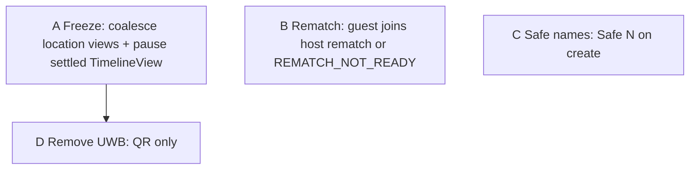

# Playtest 2 Fixes Implementation Plan

> **For agentic workers:** REQUIRED SUB-SKILL: Use superpowers:subagent-driven-development (recommended) or superpowers:executing-plans to implement this plan task-by-task. Steps use checkbox (`- [ ]`) syntax for tracking.

**Goal:** Fix the four issues from the 2026-11-18 park playtest: hunt-phase freezes, rematch for non-hosts, numbered create-safe zones, and full UWB removal (QR-only tagging).

**Architecture:** Four independently shippable tracks. Prefer one branch `cursor/playtest-2-fixes-2a9d` if executing together; otherwise split by track. Freeze fix is P0 — every location currently fans out a full `view` to all sockets, and the live map runs a 30 fps `TimelineView` whenever `glidePeople` is true. Rematch stores the successor lobby id on the ended game’s `result` JSON (no Alembic). Create-safe names become `Safe N`. UWB code, WS messages, routes, schema enum, and Nearby Interaction client are deleted; tag method is QR-only.

**Tech Stack:** FastAPI + GameSession engine + pytest; SwiftUI iOS client + XCTest; WebSocket view broadcast; MapKit `HuntMap`.

## Global Constraints

- Branch naming: `cursor/<descriptive-name>-2a9d` (AGENTS.md). Do not merge, open a PR, or deploy unless Scott asks.
- English code/comments; `TODO:` for unfinished; never swallow exceptions; no secrets or coordinates in logs.
- Distances: 111,320 m per degree; `is_decoy` never on the wire; engine does not call `datetime.now()` or the global `random`.
- Server verify: `cd server && . .venv/bin/activate && pytest -q && ruff check .`
- iOS verify when simulator available: `xcodebuild test -project ios/Manhunt.xcodeproj -scheme Manhunt -destination 'platform=iOS Simulator,name=iPhone 16 Pro,OS=18.4'`
- Do not mark human gates done in `docs/superpowers/plans/2026-11-09-remaining-benchmarks.md`. When UWB is removed, move Phase **3.1** entries to Closed as **cancelled / removed** with the commit hash (do not claim the two-phone measurement passed).
- Source playtest log: `playtest-logs/2026-11-18-playtest-events.md` (KKPRP3: two `safe_created`; multiple hunts with `final_ping` / `signal_lost` during active).

## Scope note

These tracks do not share runtime interfaces beyond shared ErrorCode / AppStore touch points. They can be four PRs. Execute Freeze before UWB removal if both land in one branch (UWB traffic is one amplifier of the freeze, but not the root cause).

## File map

| Track | Create | Modify | Delete |
|-------|--------|--------|--------|
| A Freeze | `server/tests/sim/test_location_broadcast.py` | `server/app/realtime/ws.py`; `ios/Manhunt/HuntMap.swift`; `ios/Manhunt/LiveGameView.swift` (overlay hit-testing); optionally `ios/Manhunt/LiveHUD.swift` if its 30 Hz clock stays hot when rate is 0 | — |
| B Rematch | — | `server/app/errors.py`; `server/app/games/service.py`; `server/tests/api/test_rematch.py`; `ios/Manhunt/Domain/ErrorCode.swift`; `ios/Manhunt/ResultsView.swift`; `ios/Manhunt/Store/AppStore.swift`; `ios/Manhunt/Networking/FakeGameService.swift`; `ios/ManhuntTests/AppStoreTests.swift` | — |
| C Safe names | — | `server/app/engine/modules/power_ups.py`; `server/tests/engine/test_power_ups.py`; `ios/Manhunt/Editor/ArenaEditorModel.swift` | — |
| D UWB out | — | tag_policy, modules schema, OfflineModuleSchema, session/state/ws/manager/routes/service, AppStore, LiveGame*, GameSocket, TagChrome, DTOs, APIClient, demo bots/controls, Info plists, remaining-benchmarks | `server/app/engine/uwb.py`; `server/tests/engine/test_uwb_peers.py`; `server/tests/api/test_uwb_relay.py`; UWB-only cases in `test_uwb_and_spawn.py` / `test_tag.py` / bot method loops; `ios/Manhunt/Location/UWBRanger.swift`; UWB-only iOS tests |



---

### Task 1: Freeze — location must not broadcast every fix

**Files:**
- Create: `server/tests/sim/test_location_broadcast.py`
- Modify: `server/app/realtime/ws.py` (location branch ~94–141)
- Test: `server/tests/sim/test_location_broadcast.py`

**Interfaces:**
- Consumes: existing WS `location` message shape; `SessionManager.broadcast`; 1 Hz `tick_loop`
- Produces: location updates mutate engine state + persist; **views are pushed only by `tick_loop` (and non-location actions that already broadcast)**. Remove `await manager.broadcast(game_id)` and `await manager.push_uwb_peers(game_id)` from the location branch (UWB push goes away entirely in Task 7; until then, dropping it on location is correct — peers still refresh on tick if anything remains).

**Why:** With 3 phones each sending location (client: ≥3 m or ≥2.5 s in `LocationReporter`; server floor 0.5 s), every fix calls `broadcast` → full `build_view` × N sockets, on top of the 1 Hz tick. Playtest symptom: UI freezes until a power-up forces a discrete `apply` / layout change / 1 s glide, then sticks again. Evidence: `ws.py` location → `broadcast`; `LiveGameView` always sets `glidePeople: true`; `HuntMap` runs `TimelineView` at 30 fps whenever `animates` is true (`PlayerGlide.isSettled` unused); animations plan already flagged MapKit content-diffing risk.

- [ ] **Step 1: Write the failing test**

```python
"""Location updates state without an immediate view broadcast; the tick pushes views."""

import json
from uuid import uuid4

import anyio
from fastapi.testclient import TestClient

from app.engine.arena import arena_to_dict
from tests.engine.helpers import square


def _auth(client: TestClient, name: str) -> dict:
    response = client.post(
        "/v1/auth/dev",
        json={"display_name": name, "installation_id": str(uuid4())},
    )
    assert response.status_code == 200, response.text
    return response.json()


def _hdr(token: str) -> dict[str, str]:
    return {"Authorization": f"Bearer {token}"}


def _next(ws, timeout: float = 2):
    async def receive():
        with anyio.fail_after(timeout):
            message = await ws._send_rx.receive()
        if message["type"] == "websocket.close":
            raise AssertionError(f"socket closed: {message.get('code')}")
        return json.loads(message["text"])

    try:
        return ws.portal.call(receive)
    except TimeoutError as exc:
        raise AssertionError("expected a websocket frame") from exc


def _drain_views(ws, limit: int = 20) -> list[dict]:
    """Pull queued frames until a short idle gap; return view payloads only."""
    views: list[dict] = []
    for _ in range(limit):
        try:
            frame = _next(ws, timeout=0.15)
        except AssertionError:
            break
        if frame["type"] == "view":
            views.append(frame["data"])
    return views


def test_location_does_not_push_a_view_until_tick(client: TestClient) -> None:
    host = _auth(client, "Casey")
    guest = _auth(client, "Riley")
    arena = client.post(
        "/v1/arenas",
        json=arena_to_dict(square()),
        headers=_hdr(host["access_token"]),
    )
    assert arena.status_code == 200, arena.text
    game = client.post(
        "/v1/games",
        json={
            "arena_id": arena.json()["id"],
            "preset_id": "classic",
            "overrides": {"head_start": {"enabled": False}},
        },
        headers=_hdr(host["access_token"]),
    )
    assert game.status_code == 200, game.text
    game_id = game.json()["id"]
    client.post(
        "/v1/games/join",
        json={"join_code": game.json()["join_code"]},
        headers=_hdr(guest["access_token"]),
    )
    client.post(
        f"/v1/games/{game_id}/roles",
        json={
            "mode": "manual",
            "assignments": {
                host["user"]["id"]: "hider",
                guest["user"]["id"]: "seeker",
            },
        },
        headers=_hdr(host["access_token"]),
    )
    started = client.post(f"/v1/games/{game_id}/start", headers=_hdr(host["access_token"]))
    assert started.status_code == 200, started.text

    with client.websocket_connect(f"/v1/games/{game_id}/ws") as host_ws:
        host_ws.send_json({"type": "hello", "data": {"token": host["access_token"]}})
        assert _next(host_ws)["type"] == "welcome"
        assert _next(host_ws)["type"] == "view"
        _drain_views(host_ws)

        # Three rapid location reports (server-side throttle is 0.5s; space them).
        for i in range(3):
            host_ws.send_json(
                {
                    "type": "location",
                    "data": {
                        "lat": 40.6616 + i * 0.00001,
                        "lon": -73.9688,
                        "accuracy_m": 5.0,
                        "flag": "normal",
                    },
                }
            )
            # No immediate view after a location. A short wait must not yield one.
            try:
                frame = _next(host_ws, timeout=0.2)
            except AssertionError:
                continue
            assert frame["type"] != "view", (
                "location must not broadcast a view; tick_loop owns view push"
            )

        # Engine state still recorded.
        session = client.app.state.manager.sessions[__import__("uuid").UUID(game_id)]
        assert session.state.players[__import__("uuid").UUID(host["user"]["id"])].location is not None
```

- [ ] **Step 2: Run test to verify it fails**

Run: `cd server && . .venv/bin/activate && pytest tests/sim/test_location_broadcast.py::test_location_does_not_push_a_view_until_tick -v`

Expected: FAIL — a `view` arrives within 0.2 s of a location (current `broadcast` on location).

- [ ] **Step 3: Write minimal implementation**

In `server/app/realtime/ws.py`, delete only these two lines at the end of the location branch (after `persist_location`):

```python
                    await manager.broadcast(game_id)
                    await manager.push_uwb_peers(game_id)
```

Leave parse / validation / `record_location` / `persist_location` untouched. Add this comment where the broadcast was:

```python
                    # Views ride the 1 Hz tick_loop. Broadcasting here multiplies
                    # with every phone (~2 Hz × N) and freezes the live MapKit UI.
```

Keep `broadcast` on join/roles/start/purchase/tag/etc. unchanged.

- [ ] **Step 4: Run test to verify it passes**

Run: `cd server && . .venv/bin/activate && pytest tests/sim/test_location_broadcast.py -v && pytest -q && ruff check .`

Expected: new test PASS; full suite green. If any test assumed an immediate view after location (e.g. crash recovery), update that test to call `manager.broadcast` via a tick or an explicit broadcast helper in the test.

- [ ] **Step 5: Commit**

```bash
git add server/tests/sim/test_location_broadcast.py server/app/realtime/ws.py
git commit -m "$(cat <<'EOF'
fix: stop broadcasting a full view on every location fix

Park playtest freezes matched N phones × 2 Hz location fan-out.
Views now advance on the 1 Hz tick like the glide model expects.
EOF
)"
```

---

### Task 2: Freeze — pause HuntMap TimelineView when pins are settled

**Files:**
- Modify: `ios/Manhunt/HuntMap.swift`
- Test: `ios/ManhuntTests/PlayerGlideTests.swift::testSettledOnlyAfterEveryGlideFinishes` already covers `isSettled` — do not duplicate it. This task is a HuntMap behavior change; verify PlayerGlide tests still pass.

**Interfaces:**
- Consumes: `PlayerGlide.isSettled(at:)` (already implemented)
- Produces: `HuntMap` only runs the 30 fps `TimelineView` while a glide, zone-shrink clock, or lockdown fade needs frames; live hunt stops continuous camera callbacks

- [ ] **Step 1: Confirm settle helper (no new test required)**

Run: `xcodebuild test -project ios/Manhunt.xcodeproj -scheme Manhunt -destination 'platform=iOS Simulator,name=iPhone 16 Pro,OS=18.4' -only-testing:ManhuntTests/PlayerGlideTests/testSettledOnlyAfterEveryGlideFinishes`

Expected: PASS. If the simulator is missing, note that and continue — do not invent a pass.

- [ ] **Step 2: Implement HuntMap pause + camera frequency**

Replace the `@State` / `animates` / `body` open of `HuntMap` with:

```swift
    @State private var position: MapCameraPosition = .automatic
    @State private var crosshair = VisualPoint(latitude: 40.6616, longitude: -73.9688)
    @State private var glide = PlayerGlide()
    @State private var safeDim: Double = 0
    @State private var glideAnimating = false
    @State private var settleTask: Task<Void, Never>?

    private var animates: Bool { glideAnimating || zoneShrink != nil || safeDim > 0 || lockdownActive }

    var body: some View {
        TimelineView(.animation(minimumInterval: 1.0 / 30.0, paused: !animates)) { timeline in
            mapContent(now: timeline.date)
        }
        .onAppear {
            glide.retarget(people, now: Date())
            safeDim = lockdownActive ? 1 : 0
            markGlideNeedsFrames()
        }
        .onChange(of: people) { _, updated in
            glide.retarget(updated, now: Date())
            markGlideNeedsFrames()
        }
        .onChange(of: lockdownActive) { _, active in
            withAnimation(.easeInOut(duration: 0.75)) {
                safeDim = active ? 1 : 0
            }
        }
    }

    private func markGlideNeedsFrames() {
        guard glidePeople else {
            glideAnimating = false
            settleTask?.cancel()
            return
        }
        glideAnimating = true
        settleTask?.cancel()
        settleTask = Task { @MainActor in
            try? await Task.sleep(for: .seconds(PlayerGlide.maxDuration + 0.05))
            guard !Task.isCancelled else { return }
            if glide.isSettled(at: Date()) {
                glideAnimating = false
            }
        }
    }
```

In `mapContent`, change camera observation so the live hunt (no `onCrosshair`) does not stream continuous callbacks:

```swift
            .onMapCameraChange(frequency: onCrosshair == nil ? .onEnd : .continuous) { context in
                let center = context.region.center
                crosshair = VisualPoint(latitude: center.latitude, longitude: center.longitude)
                onCrosshair?(crosshair)
            }
```

- [ ] **Step 3: Stop live HUD chrome from stealing map hits**

In `ios/Manhunt/LiveGameView.swift`, the top `VStack` (banners + spacers above the dock) can intercept pans. On the non-interactive banner column / `Spacer` regions, set `.allowsHitTesting(false)` so only real buttons (Scan, power chips, host menu) receive touches. Do **not** disable hit testing on the power dock or sheets.

Also confirm `LiveHUD.swift`: its `TimelineView` already uses `paused: rate == 0` — leave it unless Instruments shows it still firing during active; no change required if paused correctly.

- [ ] **Step 4: Re-run PlayerGlide tests**

Run: `xcodebuild test -project ios/Manhunt.xcodeproj -scheme Manhunt -destination 'platform=iOS Simulator,name=iPhone 16 Pro,OS=18.4' -only-testing:ManhuntTests/PlayerGlideTests`

Expected: PASS (or honest “no simulator” note).

- [ ] **Step 5: Commit**

```bash
git add ios/Manhunt/HuntMap.swift ios/Manhunt/LiveGameView.swift
git commit -m "$(cat <<'EOF'
fix: pause live map TimelineView when player glides settle

Always-on 30 fps MapKit updates during hunt matched the park freezes.
Camera crosshair drops to onEnd on the live map; banner chrome no longer steals pans.
EOF
)"
```

---

### Task 3: Rematch — server allows guests once the host opened a lobby

**Files:**
- Modify: `server/app/errors.py`
- Modify: `server/app/games/service.py` (`rematch` ~422–456)
- Modify: `server/tests/api/test_rematch.py`
- Test: `server/tests/api/test_rematch.py`

**Interfaces:**
- Consumes: ended `GameRow`, membership via `require_member` / `require_host`
- Produces:
  - Host `POST /v1/games/{id}/rematch` → creates lobby, sets `row.result["rematch_game_id"] = str(new_id)`, returns host view (unchanged success shape)
  - Guest `POST /v1/games/{id}/rematch` → if `rematch_game_id` present, joins that lobby as non-host and returns lobby view; else `409` `REMATCH_NOT_READY` with message `"Host hasn't started a rematch yet."`
  - New `ErrorCode.REMATCH_NOT_READY = "REMATCH_NOT_READY"`

- [ ] **Step 1: Write the failing tests**

Replace `test_rematch_rejects_non_host_and_live_games` and add a guest-join test in `server/tests/api/test_rematch.py`:

```python
def test_rematch_rejects_live_games(client: TestClient) -> None:
    host = _auth(client, "Casey")
    headers = _headers(host["access_token"])
    arena = client.post(
        "/v1/arenas",
        json=arena_to_dict(square()),
        headers=headers,
    )
    game = client.post(
        "/v1/games",
        json={"arena_id": arena.json()["id"], "preset_id": "classic"},
        headers=headers,
    )
    game_id = game.json()["id"]
    live = client.post(f"/v1/games/{game_id}/rematch", headers=headers)
    assert live.status_code == 409
    assert live.json()["error"]["code"] == "WRONG_PHASE"


def test_guest_rematch_before_host_returns_rematch_not_ready(client: TestClient) -> None:
    host = _auth(client, "Casey")
    ended = _ended_game(client, host)
    denied = client.post(
        f"/v1/games/{ended['id']}/rematch",
        headers=_headers(ended["guest"]["access_token"]),
    )
    assert denied.status_code == 409
    body = denied.json()["error"]
    assert body["code"] == "REMATCH_NOT_READY"
    assert "host" in body["message"].lower()


def test_guest_rematch_joins_host_lobby(client: TestClient) -> None:
    host = _auth(client, "Casey")
    ended = _ended_game(client, host)
    game_id = ended["id"]
    host_rematch = client.post(
        f"/v1/games/{game_id}/rematch",
        headers=ended["headers"],
    )
    assert host_rematch.status_code == 200, host_rematch.text
    new_id = host_rematch.json()["game_id"]

    guest_rematch = client.post(
        f"/v1/games/{game_id}/rematch",
        headers=_headers(ended["guest"]["access_token"]),
    )
    assert guest_rematch.status_code == 200, guest_rematch.text
    body = guest_rematch.json()
    assert body["game_id"] == new_id
    assert body["phase"] == "lobby"
    assert body["you"]["is_host"] is False
    names = {p["display_name"] for p in body["players"]}
    assert "Casey" in names and "Riley" in names
```

Keep `test_rematch_opens_a_new_lobby_with_same_rules` as-is (still asserts host path).

- [ ] **Step 2: Run tests to verify they fail**

Run: `cd server && . .venv/bin/activate && pytest tests/api/test_rematch.py -v`

Expected: FAIL — guest still gets `NOT_HOST` / `REMATCH_NOT_READY` undefined.

- [ ] **Step 3: Write minimal implementation**

`server/app/errors.py` — add:

```python
    REMATCH_NOT_READY = "REMATCH_NOT_READY"
```

`server/app/games/service.py` — replace `rematch` with:

```python
    async def rematch(self, session: AsyncSession, user: User, game_id: UUID) -> GameSession:
        """Host opens a fresh lobby; guests join it once the host has rematched."""
        row, _ = await self.require_member(session, game_id, user)
        if row.status != "ended":
            raise ApiError(
                ErrorCode.WRONG_PHASE,
                "Rematch is only available after the hunt ends.",
                status_code=409,
            )
        is_host = row.host_id == user.id
        if is_host:
            return await self._host_rematch(session, user, row)

        rematch_raw = (row.result or {}).get("rematch_game_id")
        if not rematch_raw:
            raise ApiError(
                ErrorCode.REMATCH_NOT_READY,
                "Host hasn't started a rematch yet.",
                status_code=409,
            )
        try:
            rematch_id = UUID(str(rematch_raw))
        except (TypeError, ValueError) as exc:
            raise ApiError(
                ErrorCode.INTERNAL,
                "Rematch lobby id is corrupt.",
                status_code=500,
            ) from exc
        return await self._join_rematch_lobby(session, user, rematch_id)

    async def _host_rematch(
        self, session: AsyncSession, user: User, row: GameRow
    ) -> GameSession:
        existing = (row.result or {}).get("rematch_game_id")
        if existing:
            # Idempotent: host tapping twice returns the same lobby.
            return await self._join_rematch_lobby(session, user, UUID(str(existing)), as_host=True)

        join_code = await self._unique_code(session)
        seed = random.SystemRandom().randint(1, 2**31 - 1)
        new_row = GameRow(
            id=uuid4(),
            join_code=join_code,
            host_id=user.id,
            status="lobby",
            arena_snapshot=deepcopy(row.arena_snapshot),
            preset_snapshot=deepcopy(row.preset_snapshot),
            seed=seed,
            inputs=[],
        )
        session.add(new_row)
        session.add(GamePlayerRow(game_id=new_row.id, user_id=user.id, role="unassigned"))
        payload = dict(row.result or {})
        payload["rematch_game_id"] = str(new_row.id)
        row.result = payload
        await session.commit()
        game = self.manager.register(
            new_row.id,
            new_row.arena_snapshot,
            new_row.preset_snapshot,
            seed,
            join_code,
        )
        game.add_player(user.id, user.display_name, is_host=True)
        await self.persist_inputs(session, game)
        await session.commit()
        return game

    async def _join_rematch_lobby(
        self,
        session: AsyncSession,
        user: User,
        rematch_id: UUID,
        *,
        as_host: bool = False,
    ) -> GameSession:
        new_row = await session.get(GameRow, rematch_id)
        if new_row is None or new_row.status not in {"lobby"}:
            raise ApiError(
                ErrorCode.GAME_NOT_FOUND,
                "The rematch lobby is gone.",
                status_code=404,
            )
        game = self._live(new_row)
        if user.id in game.state.players:
            return game
        from sqlalchemy import func

        count = await session.scalar(
            select(func.count())
            .select_from(GamePlayerRow)
            .where(GamePlayerRow.game_id == rematch_id)
        )
        if (count or 0) >= 20:
            raise ApiError(ErrorCode.GAME_FULL, "This lobby is full.", status_code=409)
        self._reject_duplicate_display_name(game, user)
        member = await session.get(GamePlayerRow, (rematch_id, user.id))
        if member is None:
            session.add(GamePlayerRow(game_id=rematch_id, user_id=user.id, role="unassigned"))
        game.add_player(
            user.id,
            user.display_name,
            is_host=as_host and new_row.host_id == user.id,
        )
        await self.persist_inputs(session, game)
        await session.commit()
        await self.manager.broadcast(rematch_id)
        return game
```

Cap `20` matches `join` in the same file.

- [ ] **Step 4: Run tests**

Run: `cd server && . .venv/bin/activate && pytest tests/api/test_rematch.py -v && pytest -q && ruff check .`

Expected: PASS.

- [ ] **Step 5: Commit**

```bash
git add server/app/errors.py server/app/games/service.py server/tests/api/test_rematch.py
git commit -m "$(cat <<'EOF'
feat: let guests join a rematch once the host opens one

Guest rematch before the host gets REMATCH_NOT_READY with a clear message.
EOF
)"
```

---

### Task 4: Rematch — iOS shows the button for everyone

**Files:**
- Modify: `ios/Manhunt/Domain/ErrorCode.swift`
- Modify: `ios/Manhunt/ResultsView.swift`
- Modify: `ios/Manhunt/Store/AppStore.swift` (`rematch` / `rematchRemote`)
- Modify: `ios/Manhunt/Networking/FakeGameService.swift` (`rematchSync`)
- Modify: `ios/ManhuntTests/AppStoreTests.swift`
- Test: `ios/ManhuntTests/AppStoreTests.swift`

**Interfaces:**
- Consumes: `ErrorCode.rematchNotReady`; `GameService.rematch`
- Produces: Rematch button always on Results; guest success → lobby; guest failure → `note` with server message

- [ ] **Step 1: Write the failing tests + FakeGameService rematch guest path**

Add to `ErrorCode.swift`:

```swift
    case rematchNotReady = "REMATCH_NOT_READY"
```

On `FakeGame` (in `FakeGameService.swift`), add `var rematchGameID: UUID?`.

Replace `rematchSync` with:

```swift
    func rematchSync(gameID: UUID) throws -> PlayerViewDTO {
        guard var old = games[gameID] else {
            throw ServiceError(code: .gameNotFound, message: "Game not found.")
        }
        guard old.phase == .ended else {
            throw ServiceError(code: .wrongPhase, message: "Rematch is only available after the hunt ends.")
        }
        let you = signedIn
        let youAreHost = old.youAreHost
        if youAreHost {
            if let existing = old.rematchGameID, let lobby = games[existing] {
                return lobby.view()
            }
            let id = UUID()
            let hostID = you?.id ?? old.players.first(where: \.isHost)?.id ?? UUID()
            let hostName = you?.displayName ?? old.players.first(where: \.isHost)?.name ?? "You"
            let game = FakeGame(
                id: id,
                joinCode: JoinCode.generate(using: &rng),
                youAreHost: true,
                players: [
                    FakePlayer(id: hostID, name: hostName, role: .unassigned, isHost: true),
                ]
            )
            games[id] = game
            old.rematchGameID = id
            games[gameID] = old
            return game.view()
        }
        guard let rematchID = old.rematchGameID, var lobby = games[rematchID] else {
            throw ServiceError(
                code: .rematchNotReady,
                message: "Host hasn't started a rematch yet."
            )
        }
        let guestID = you?.id ?? UUID()
        let guestName = you?.displayName ?? "Guest"
        if !lobby.players.contains(where: { $0.id == guestID }) {
            lobby.players.append(
                FakePlayer(id: guestID, name: guestName, role: .unassigned, isHost: false)
            )
        }
        lobby.youAreHost = false
        games[rematchID] = lobby
        return lobby.view()
    }

    /// Test helper: mark PARK42 (or any id) ended so Results rematch can run as a guest.
    func markEnded(_ gameID: UUID) {
        games[gameID]?.phase = .ended
    }
```

In `ios/ManhuntTests/AppStoreTests.swift`, replace `testRematchIsHostOnly` with:

```swift
    @MainActor
    func testGuestRematchBeforeHostSurfacesRematchNotReady() {
        let fake = FakeGameService()
        let store = AppStore(service: fake)
        store.signInPreview()
        _ = store.join(code: "PARK42")
        fake.markEnded(store.match!.snapshot.gameId)
        store.screen = .results
        store.rematch()
        XCTAssertEqual(store.screen, .results)
        XCTAssertEqual(store.lastError, .service(.rematchNotReady))
        XCTAssertTrue(store.note?.lowercased().contains("host") == true)
    }

    @MainActor
    func testGuestRematchJoinsHostLobby() throws {
        let fake = FakeGameService()
        let host = AppStore(service: fake)
        host.signInPreview()
        host.createMatch(arenaID: Arena.sampleSquare().id, presetID: "classic")
        host.randomizeRoles(seekerCount: 1)
        _ = host.startMatch()
        host.endMatch()
        let endedID = host.match!.snapshot.gameId
        host.rematch()
        let rematchID = host.match!.snapshot.gameId
        XCTAssertNotEqual(rematchID, endedID)

        _ = fake.signInSync("Riley Chen")
        let guest = AppStore(service: fake)
        guest.session = Session(displayName: "Riley Chen", token: "fake")
        guest.match = MatchHandle(
            snapshot: try fake.forceEndedGuestView(gameID: endedID),
            qrToken: nil,
            clockAnchorAt: nil
        )
        guest.screen = .results
        guest.rematch()
        XCTAssertEqual(guest.screen, .lobby)
        XCTAssertEqual(guest.match?.snapshot.gameId, rematchID)
        XCTAssertFalse(guest.isHost)
    }
```

Add this FakeGameService helper (keeps `games` private):

```swift
    func forceEndedGuestView(gameID: UUID) throws -> PlayerViewDTO {
        guard var game = games[gameID] else {
            throw ServiceError(code: .gameNotFound, message: "Game not found.")
        }
        game.phase = .ended
        game.youAreHost = false
        games[gameID] = game
        return game.view()
    }
```


- [ ] **Step 2: Run tests to verify they fail**

Run: `xcodebuild test … -only-testing:ManhuntTests/AppStoreTests/testGuestRematchBeforeHostSurfacesRematchNotReady`

Expected: FAIL — guest rematch no-ops on `guard isHost`.

- [ ] **Step 3: Write minimal implementation**

`ResultsView.swift`:

```swift
                HuntButton(title: "Rematch", haptic: .medium, action: store.rematch)
                    .accessibilityIdentifier("rematch")
```

(Remove the `if store.isHost` wrapper; keep Home button as-is.)

`AppStore.rematch()`:

```swift
    func rematch() {
        guard let id = match?.snapshot.gameId else { return }
        lastError = nil
        if let fake {
            do {
                let view = try fake.rematchSync(gameID: id)
                timeline = []
                note = nil
                apply(view)
                screen = .lobby
            } catch let error as ServiceError {
                lastError = .service(error.code)
                note = error.message
            } catch {
                lastError = .service(.internal)
                note = "Could not start a rematch."
            }
            return
        }
        Task { await rematchRemote(gameID: id) }
    }
```

`rematchRemote` already surfaces `error.message` — keep that so `REMATCH_NOT_READY` shows `"Host hasn't started a rematch yet."`

- [ ] **Step 4: Run tests**

Run: `xcodebuild test … -only-testing:ManhuntTests/AppStoreTests`

Expected: PASS for rematch cases.

- [ ] **Step 5: Commit**

```bash
git add ios/Manhunt/Domain/ErrorCode.swift ios/Manhunt/ResultsView.swift ios/Manhunt/Store/AppStore.swift ios/Manhunt/Networking/FakeGameService.swift ios/ManhuntTests/AppStoreTests.swift
git commit -m "$(cat <<'EOF'
feat: show Rematch for all players on results

Guests join the host's rematch lobby or see that the host has not started one.
EOF
)"
```

---

### Task 5: Number created safe zones

**Files:**
- Modify: `server/app/engine/modules/power_ups.py` (`_create_safe`)
- Modify: `server/tests/engine/test_power_ups.py`
- Modify: `ios/Manhunt/Editor/ArenaEditorModel.swift` (circle safe create ~292–304)
- Test: `server/tests/engine/test_power_ups.py`

**Interfaces:**
- Consumes: current `arena.zones` of kind SAFE
- Produces: new zone name `"Safe {n}"` where `n = 1 + count(existing SAFE zones)`

- [ ] **Step 1: Write the failing test**

Extend `test_create_safe_adds_zone_and_rejects_wrong_role_or_outside` or add:

```python
def test_create_safe_numbers_zone_names() -> None:
    session, clock, hider, seeker = two_player_hunt(
        {"power_ups": {"create_safe_radius_m": 20}}
    )
    session.record_location(hider, reading(meters(100, 100), clock))
    session.state.players[hider].points = 400
    before = len([z for z in session.state.arena.zones if z.kind.value == "safe"])
    p1 = meters(80, 80)
    session.purchase(hider, "create_safe", lat=p1.lat, lon=p1.lon)
    first = [z for z in session.state.arena.zones if z.kind.value == "safe"][-1]
    assert first.name == f"Safe {before + 1}"

    session.state.players[hider].cooldowns.pop("create_safe", None)
    p2 = meters(120, 80)
    session.purchase(hider, "create_safe", lat=p2.lat, lon=p2.lon)
    second = [z for z in session.state.arena.zones if z.kind.value == "safe"][-1]
    assert second.name == f"Safe {before + 2}"
    names = [z.name for z in session.state.arena.zones if z.kind.value == "safe"]
    assert len(names) == len(set(names))
```

- [ ] **Step 2: Run test to verify it fails**

Run: `cd server && . .venv/bin/activate && pytest tests/engine/test_power_ups.py::test_create_safe_numbers_zone_names -v`

Expected: FAIL — name is still `"New safe"`.

- [ ] **Step 3: Write minimal implementation**

In `_create_safe`:

```python
def _next_safe_name(zones: list[ArenaZone]) -> str:
    existing = sum(1 for z in zones if z.kind == ZoneKind.SAFE)
    return f"Safe {existing + 1}"


def _create_safe(s: GameSession, kwargs: dict[str, Any]) -> None:
    point = GeoPoint(lat=float(kwargs["lat"]), lon=float(kwargs["lon"]))
    if not contains(point, s.state.arena.boundary):
        raise GameRuleError(ErrorCode.TARGET_OUTSIDE)
    settings = s.module_settings("power_ups")
    radius_m = float(settings.get("create_safe_radius_m", 30))
    zone = ArenaZone(
        id=uuid4(),
        name=_next_safe_name(s.state.arena.zones),
        kind=ZoneKind.SAFE,
        shape=CircleShape(center=point, radius_m=radius_m),
    )
    arena = s.state.arena
    arena.zones = list(arena.zones) + [zone]
    s.state.arena = clip_arena(arena)
    kept = next((z for z in s.state.arena.zones if z.id == zone.id), None)
    if kept is None:
        raise GameRuleError(ErrorCode.TARGET_OUTSIDE, "Safe zone could not fit in the play area.")
    s.emit(
        "safe_created",
        {
            "text": "A new safe zone appeared.",
            "zone_id": str(zone.id),
            "lat": point.lat,
            "lon": point.lon,
            "radius_m": radius_m,
        },
        tone="info",
    )
```

In `ArenaEditorModel` safe-circle finalize:

```swift
                let nextIndex = zones.filter { $0.kind == .safe }.count + 1
                var zone = ArenaZone(
                    id: UUID(),
                    name: "Safe \(nextIndex)",
                    kind: .safe,
                    shape: .circle(center: center, radiusMeters: radius)
                )
```

- [ ] **Step 4: Run tests**

Run: `cd server && . .venv/bin/activate && pytest tests/engine/test_power_ups.py::test_create_safe_numbers_zone_names tests/engine/test_power_ups.py::test_create_safe_adds_zone_and_rejects_wrong_role_or_outside -v && ruff check .`

Expected: PASS.

- [ ] **Step 5: Commit**

```bash
git add server/app/engine/modules/power_ups.py server/tests/engine/test_power_ups.py ios/Manhunt/Editor/ArenaEditorModel.swift
git commit -m "$(cat <<'EOF'
fix: number created safe zones so Move safe can tell them apart

Create-safe and the editor now name zones Safe 1, Safe 2, …
EOF
)"
```

---

### Task 6: Remove UWB from the tag policy and module schema

**Files:**
- Modify: `server/app/engine/modules/tag_policy.py`
- Modify: `server/app/schemas/modules.py` (`tag_policy` block)
- Modify: `ios/Manhunt/OfflineModuleSchema.json` (keep in sync with server schema)
- Modify: `server/tests/engine/test_uwb_and_spawn.py` — keep spawn tests; delete or rewrite UWB tag cases to QR-only
- Delete later (Task 7): `server/app/engine/uwb.py` and UWB API tests
- Test: rewrite `test_uwb_preset_still_accepts_qr_with_pairing` style cases into `test_qr_is_the_only_tag_method`

**Interfaces:**
- Consumes: `TagClaim` with `qr_token` + GPS pairing
- Produces: `tag_policy.method` fixed to `qr` (enum values `["qr"]` only, or field removed and default `"qr"`). Dual-range UWB path removed from `check_tag`.

- [ ] **Step 1: Write the failing test**

Create `server/tests/engine/test_tag_policy_qr_only.py`:

```python
import pytest

from app.engine.modules.base import TagClaim
from app.errors import ErrorCode, GameRuleError
from app.schemas.modules import SCHEMAS
from tests.engine.helpers import meters, reading, two_player_hunt


def test_tag_policy_schema_has_no_uwb_method() -> None:
    method = SCHEMAS["tag_policy"]["fields"]["method"]
    assert method["values"] == ["qr"]
    assert "uwb" not in method["values"]


def test_claim_without_qr_token_is_rejected_even_with_ranges() -> None:
    session, clock, hider, seeker = two_player_hunt({"tag_policy": {"method": "uwb"}})
    session.record_location(hider, reading(meters(40, 40), clock))
    session.record_location(seeker, reading(meters(40, 40), clock))
    with pytest.raises(GameRuleError) as exc:
        session.claim_tag(
            TagClaim(seeker, hider, seeker_range=1.0, hider_range=1.0, qr_token=None)
        )
    assert exc.value.code == ErrorCode.TOKEN_INVALID
```


- [ ] **Step 2: Run test to verify it fails**

Run: `pytest tests/engine/test_tag_policy_qr_only.py -v`

Expected: FAIL — schema still lists `uwb`.

- [ ] **Step 3: Write minimal implementation**

`modules.py`:

Replace the whole `"tag_policy"` entry in `SCHEMAS` with:

```python
    "tag_policy": {
        "version": 1,
        "title": "Tag",
        "blurb": "Seekers scan a rotating QR code while GPS pairing is satisfied.",
        "locked": True,
        "field_order": ["method", "radius_m", "result", "pairing_m"],
        "fields": {
            "method": _enum("Method", ["qr"], "qr", ["QR code"]),
            "radius_m": _number("Radius", 1, 5, 2, step=0.5, suffix="m"),
            "result": _enum(
                "Result",
                ["eliminate", "convert"],
                "eliminate",
                ["Eliminate", "Join seekers"],
            ),
            "pairing_m": _int("Pairing", 5, 80, 30, step=5, suffix="m"),
        },
    },
```

(`radius_m` stays for preset compatibility even if QR-only tagging ignores dual-range.)

Replace `TagPolicyModule.check_tag` body after the phase/role checks with:

```python
        pairing = float(self.settings.get("pairing_m", 30))
        sloc = seeker.location
        hloc = hider.location
        if sloc is None or hloc is None:
            return ErrorCode.NOT_IN_PAIRING_RANGE
        if sloc.accuracy_m > ACCURACY_CUTOFF_M or hloc.accuracy_m > ACCURACY_CUTOFF_M:
            return ErrorCode.NOT_IN_PAIRING_RANGE
        gps = distance_m(sloc.point, hloc.point)
        bonus = min(sloc.accuracy_m, ACCURACY_BONUS_CAP_M) + min(
            hloc.accuracy_m, ACCURACY_BONUS_CAP_M
        )
        if gps > pairing + bonus:
            return ErrorCode.NOT_IN_PAIRING_RANGE
        if not claim.qr_token:
            return ErrorCode.TOKEN_INVALID
        hid = parse_qr_token(
            claim.qr_token,
            game_id=s.state.game_id,
            key=s.qr_signing_key,
            now=s.clock.now(),
        )
        if hid != claim.hider_id:
            return ErrorCode.TOKEN_INVALID
        return None
```

Delete the old early `if claim.qr_token: parse...` block and the entire `method == "uwb"` / forged-range branch.

In `ios/Manhunt/OfflineModuleSchema.json`, set `tag_policy.fields.method.values` to `["qr"]` and `labels` to `["QR code"]`, and update the module `blurb` to match the server string above.

- [ ] **Step 4: Run tests**

Run: `pytest tests/engine/test_tag_policy_qr_only.py -v && pytest -q && ruff check .`

Expected: FAIL on leftover UWB tests until Task 7 deletes them — either delete those tests in this same commit or keep this commit schema-only and finish deletions in Task 7. Prefer **one commit for schema+policy** and **one for plumbing deletion** so review stays readable; temporarily `@pytest.mark.skip` is **not** allowed — delete failing UWB tests in Task 7 immediately after, or fold Tasks 6–7 into one commit if the suite would be red in between.

- [ ] **Step 5: Commit** (only when suite is green — combine with Task 7 if needed)

```bash
git commit -m "$(cat <<'EOF'
feat: make QR the only tag method in schema and policy

Playtest confirmed QR tagging is enough; UWB method is gone from presets.
EOF
)"
```

---

### Task 7: Delete UWB relay, client ranger, and docs gates

**Files:**
- Delete: `server/app/engine/uwb.py`
- Delete: `server/tests/engine/test_uwb_peers.py`
- Delete: `server/tests/api/test_uwb_relay.py`
- Modify: `server/app/engine/session.py` — remove `set_uwb_token`, `report_uwb_range`, `prune_uwb_ranges`, `claim_uwb`, imports
- Modify: `server/app/engine/state.py` — remove `uwb_token`, `uwb_ranges`, `uwb_peer_signature`
- Modify: `server/app/realtime/ws.py` — remove `uwb_token` / `uwb_range` branches
- Modify: `server/app/realtime/manager.py` — remove `push_uwb_peers`
- Modify: `server/app/games/routes.py` — remove `UwbIn` and `POST /tags/uwb`
- Modify: `server/app/games/service.py` — remove `uwb_tag`
- Modify: `server/app/demo/bots.py` and `server/app/demo/controls.py` — delete non-`qr` dual-range `TagClaim` branches; always use QR tokens
- Modify: `server/tests/engine/test_uwb_and_spawn.py` — keep spawn/lock tests; strip UWB tag tests (rename to `test_spawn_lock.py` if clearer)
- Modify: `server/tests/engine/test_tag.py` — delete `test_far_gps_pair_cannot_be_saved_by_a_fake_uwb_reading`
- Modify: `server/tests/demo/test_bot_driver.py` — drop `method in ("qr", "uwb")` loops; QR only
- Delete: `ios/Manhunt/Location/UWBRanger.swift`
- Modify: `ios/Manhunt/Store/AppStore.swift` — remove ranger, peers, claimUWB, publish/stop UWB; drop or reword `.notInRange` copy
- Modify: `ios/Manhunt/Networking/{GameService,LiveGameService,GameSocket,FakeGameService,DTOs,APIClient}.swift` — remove `claimUWB`, `UwbTagBody`, `uwb_*` socket API
- Modify: `ios/Manhunt/LiveGameView.swift` — remove `uwbTags` / `tagMethod == "uwb"` branch
- Modify: `ios/Manhunt/Domain/TagChrome.swift` — always `"Scan tag"`
- Modify: `ios/Support/Info.plist` and `ios/Support/Info-Debug.plist` — remove `NSNearbyInteractionUsageDescription`
- Modify: Xcode project membership if `UWBRanger.swift` is explicitly listed
- Modify: `docs/superpowers/plans/2026-11-09-remaining-benchmarks.md` — close 3.1 as cancelled/removed
- Optional cleanup in same commit if no callers remain: `TagClaim.seeker_range` / `hider_range`, `ErrorCode.NOT_IN_RANGE` / `.notInRange`
- Test: full `pytest -q`; rewrite `testUwbMethodStillOffersQrScanFallback` to QR-only (`testScanLabelIsAlwaysScanTag`). `testRepublishesDiscoveryTokenAfterReconnect` is docs-only / already gone — do not recreate it.

**Interfaces:**
- Consumes: QR claim path only (`POST …/tags/qr`)
- Produces: no `uwb_*` WS messages; no Nearby Interaction usage description or ranger code


- [ ] **Step 1: Write / adjust failing client test**

Rewrite `testUwbMethodStillOffersQrScanFallback` into:

```swift
func testScanLabelIsAlwaysScanTag() {
    XCTAssertEqual(TagChrome.scanLabel(tagMethod: "qr"), "Scan tag")
    XCTAssertEqual(TagChrome.scanLabel(tagMethod: nil), "Scan tag")
    XCTAssertEqual(TagChrome.scanLabel(tagMethod: "uwb"), "Scan tag")
}
```

And `TagChrome`:

```swift
enum TagChrome {
    static func showsQRScan(tagMethod: String?) -> Bool { true }

    static func scanLabel(tagMethod: String?) -> String { "Scan tag" }
}
```

- [ ] **Step 2: Delete server UWB modules and update imports until `pytest` collects cleanly**

Remove files listed above. Grep for `uwb` / `UWB` / `NearbyInteraction` and clear hits. Demo bots already use QR tokens — leave them.

- [ ] **Step 3: Strip iOS UWB**

Remove `UWBRanger.swift` from the target. In `AppStore` init, delete ranger construction and UWB callbacks. Remove `claimUWB` from `GameService` protocol and implementations. Remove `onUWBPeers` / `sendUWBToken` / `sendUWBRange` from socket. Remove LiveGameView UWB peer Tag buttons.

- [ ] **Step 4: Run full verification**

Run:

```bash
cd server && . .venv/bin/activate && pytest -q && ruff check .
```

And iOS when possible:

```bash
xcodebuild test -project ios/Manhunt.xcodeproj -scheme Manhunt -destination 'platform=iOS Simulator,name=iPhone 16 Pro,OS=18.4'
```

Expected: server green; iOS green or “simulator unavailable” stated honestly.

Update remaining-benchmarks Closed section:

```markdown
- **3.1 Device ranging / UWB (cancelled).** `<commit>`, playtest 2 decision: QR tag only. Nearby Interaction relay, `/tags/uwb`, and iOS ranger removed. Do not treat the two-phone NI cap measurement as done — the feature is gone.
```

Remove or strike the Open **3.1** bullet accordingly (leave acceptance text under Closed per AGENTS.md).

- [ ] **Step 5: Commit**

```bash
git add -A
git commit -m "$(cat <<'EOF'
feat: remove UWB ranging; QR is the only tag path

Drops Nearby Interaction, uwb WS messages, and the uwb tag method after park playtest.
EOF
)"
```

---

## Self-review

1. **Spec coverage**
   - Freezes (3 devices, power-up briefly helps) → Tasks 1–2 (broadcast storm + Map TimelineView / camera)
   - Rematch for non-hosts + error if host has not rematched → Tasks 3–4
   - Number created safe zones → Task 5
   - Remove UWB entirely → Tasks 6–7
2. **Placeholder scan** — Task 4 uses `markEnded` / `forceEndedGuestView` / `rematchGameID` on FakeGameService; no undefined test helpers.
3. **Type consistency** — `REMATCH_NOT_READY` / `rematchNotReady` pair; safe names `Safe N`; no remaining `method == "uwb"` after Task 7.

## Manual playtest gate (human, not checkable here)

After Tasks 1–7: three phones, 10+ minute active hunt — map stays interactive without needing a power-up to “unstick”; Rematch visible to guests; create-safe shows distinct names in Move safe; no UWB UI.

---

Plan complete and saved to `docs/superpowers/plans/2026-11-18-playtest-2-fixes.md`. Two execution options:

**1. Subagent-Driven (recommended)** — I dispatch a fresh subagent per task, review between tasks, fast iteration

**2. Inline Execution** — Execute tasks in this session using executing-plans, batch execution with checkpoints

Which approach?
