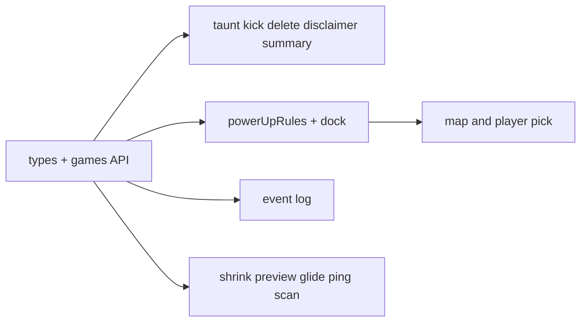

---
todos:
  - id: t1-api
    status: completed
    content: 'Task 1: types + API clients (taunt, remove, power-ups, events, ack, delete)'
  - id: t2-taunt
    status: in_progress
    content: 'Task 2: LiveMap taunt button'
  - id: t3-kick
    content: 'Task 3: Lobby host kick'
    status: pending
  - id: t4-delete
    content: 'Task 4: Account delete'
    status: pending
  - id: t5-disclaimer
    content: 'Task 5: First-hunt safety disclaimer'
    status: pending
  - id: t6-lobby
    content: 'Task 6: Rules summary + move circle center'
    status: pending
  - id: t7-log
    content: 'Task 7: Event log live + results'
    status: pending
  - id: t8-rules
    content: 'Task 8: powerUpRules helper'
    status: pending
  - id: t9-dock
    content: 'Task 9: Non-targeted power-up dock'
    status: pending
  - id: t10-targeted
    content: 'Task 10: Targeted power-ups (map/player/zone)'
    status: pending
  - id: t11-scan
    content: 'Task 11: Tag scan polish'
    status: pending
  - id: t12-shrink
    content: 'Task 12: Zone-shrink preview'
    status: pending
  - id: t13-polish
    content: 'Task 13: Pin glide + ping flash'
    status: pending
  - id: t14-docs
    content: 'Task 14: Docs, full verify, PR'
    status: pending
name: Web friend parity
overview: 'Verbose Composer implementation plan to bring web play parity with fully-shipped iOS friend-client features (taunt, kick, account delete, safety disclaimer, event log, power-ups, lobby center/summary, scan polish, zone-shrink preview, pin glide/ping flash)—not editors or platform-only APIs.'
isProject: false
---
# Web friend-parity Implementation Plan

> **For agentic workers:** REQUIRED SUB-SKILL: Use superpowers:subagent-driven-development (recommended) or superpowers:executing-plans to implement this plan task-by-task. Steps use checkbox (`- [ ]`) syntax for tracking.
>
> **Also save a copy to** [`docs/superpowers/plans/2026-11-20-web-friend-parity.md`](docs/superpowers/plans/2026-11-20-web-friend-parity.md) on first commit so the repo keeps the source of truth (writing-plans convention).

**Goal:** Web can play a fair mixed hunt with iOS: same dock actions friends need (taunt, power-ups), same host lobby tools (kick, move center, rules summary), account delete, first-hunt safety disclaimer, event log, and light live polish—without becoming a second arena/preset editor.

**Architecture:** Thin React UI over existing FastAPI routes. Extend [`web/src/api/types.ts`](web/src/api/types.ts) + [`web/src/api/games.ts`](web/src/api/games.ts) first; pure helpers for power-up rules / rules summary / pin glide; wire into Lobby, LiveMap, Result, Account, SignIn/Home. Server already implements the endpoints—no engine rebuild.

**Tech Stack:** Vite + React 19 + TypeScript + Vitest + Testing Library; Leaflet map; same `PlayerView` WebSocket views as iOS.

## Global Constraints

- Product lane: web = friends who cannot sideload; **no** arena/preset editors, demo panel, Sign in with Apple, push, flashlight, haptics, background GPS.
- English UI/comments; leave `TODO:` where unfinished; do not swallow errors.
- TDD: failing test → implement → pass → commit per task.
- Branch: `cursor/web-friend-parity-7c05` off current `main`.
- Verify: `cd web && npm test -- --run` after each task cluster; `npm run build` before PR.
- One open PR at the end (or stacked small PRs per phase if preferred—default **one PR**).
- Match iOS denial copy patterns where server returns `error.code` / message.

## File map (create / modify)

| File | Responsibility |
|------|----------------|
| [`web/src/api/types.ts`](web/src/api/types.ts) | `PowerUpRow`, taunt fields, `safety_needs_ack`, timeline event type |
| [`web/src/api/games.ts`](web/src/api/games.ts) | `taunt`, `removePlayer`, `purchasePowerUp`, `fetchGameEvents`, `ackSafety` |
| [`web/src/api/auth.ts`](web/src/api/auth.ts) | `deleteAccount` → `DELETE /v1/me` |
| [`web/src/game/powerUpRules.ts`](web/src/game/powerUpRules.ts) | Port of iOS `PowerUpRules` (decide / requiresTarget / requiresMapPoint) |
| [`web/src/game/rulesSummary.ts`](web/src/game/rulesSummary.ts) | Format lobby rules line from `view.timers` |
| [`web/src/game/safetyDisclaimer.ts`](web/src/game/safetyDisclaimer.ts) | localStorage one-time disclaimer gate |
| [`web/src/map/pinGlide.ts`](web/src/map/pinGlide.ts) | Interpolate pin lat/lon over ~400ms |
| [`web/src/map/pingFlash.ts`](web/src/map/pingFlash.ts) | Detect new reveal ids → flash payload |
| [`web/src/screens/Lobby.tsx`](web/src/screens/Lobby.tsx) | Kick, rules summary, move center |
| [`web/src/screens/LiveMap.tsx`](web/src/screens/LiveMap.tsx) | Taunt, power dock, pick modes, event log, shrink preview, glide/flash |
| [`web/src/screens/Result.tsx`](web/src/screens/Result.tsx) | Event log section |
| [`web/src/screens/Account.tsx`](web/src/screens/Account.tsx) | Delete account |
| [`web/src/screens/Home.tsx`](web/src/screens/Home.tsx) / App | Gate enter-live with disclaimer (after start or on first LiveMap mount) |
| [`web/src/screens/QrScan.tsx`](web/src/screens/QrScan.tsx) | Scan polish (clearer camera-fail copy, always-visible manual) |
| [`docs/superpowers/plans/2026-11-19-web-later-features.md`](docs/superpowers/plans/2026-11-19-web-later-features.md) | Mark shipped items |



---

### Task 1: Extend types + API clients

**Files:**
- Modify: `web/src/api/types.ts`
- Modify: `web/src/api/games.ts`
- Modify: `web/src/api/auth.ts`
- Test: `web/src/api/games.parity.test.ts` (new), `web/src/api/auth.test.ts` (extend)

**Produces:**
- `PowerUpRow`, `TimelineEvent`
- `tauntGame`, `removeLobbyPlayer`, `purchasePowerUp`, `fetchGameEvents`, `ackSafety`, `deleteAccount`

- [ ] **Step 1: Write failing API tests**

```typescript
// web/src/api/games.parity.test.ts
it('POSTs taunt and returns the player view', async () => { /* mock fetch → /taunt */ })
it('POSTs remove player', async () => { /* .../players/{id}/remove */ })
it('POSTs power-up purchase with id and optional target', async () => {})
it('GETs /events as timeline', async () => {})
```

- [ ] **Step 2: Run** `cd web && npm test -- --run src/api/games.parity.test.ts` — expect FAIL (exports missing).

- [ ] **Step 3: Add types**

```typescript
export type PowerUpRow = {
  id: string
  title: string
  cost: number
  role: string
  available: boolean
  cooldown_s?: number
  needs_target?: boolean
}
// on you: taunt_cooldown_s?: number; taunt_enabled?: boolean
// on PlayerView: power_ups?: PowerUpRow[]; safety_needs_ack?: boolean
export type TimelineEvent = { seq: number; type: string; payload: Record<string, unknown> }
```

- [ ] **Step 4: Implement API wrappers** (mirror existing `pauseGame` style with `withAuthRetry` callers outside).

Routes (already on server):
- `POST /v1/games/{id}/taunt`
- `POST /v1/games/{id}/players/{playerId}/remove`
- `POST /v1/games/{id}/power-ups` body `{ id, ...extra }`
- `GET /v1/games/{id}/events` → `{ events }`
- `POST /v1/games/{id}/safety/ack`
- `DELETE /v1/me`

- [ ] **Step 5: Tests pass; commit** `feat(web): API helpers for friend-parity routes`

---

### Task 2: Taunt on LiveMap dock

**Files:** Modify `web/src/screens/LiveMap.tsx`, `LiveMap.test.tsx`, `web/src/api/types.ts` (if needed)

**Consumes:** `tauntGame`, `you.taunt_enabled`, `you.taunt_cooldown_s`, role `hider`, phase `active`

- [ ] **Step 1: Failing test** — hider in `active` sees Taunt; disabled when cooldown > 0; seeker does not see it; click calls API and `onView`.

- [ ] **Step 2: Implement** button in dock next to Show tag; surface `ApiError.message` in `localNote`.

- [ ] **Step 3: Commit** `feat(web): hider taunt on live dock`

---

### Task 3: Host kick in lobby

**Files:** `web/src/screens/Lobby.tsx`, `Lobby.test.tsx`

**Consumes:** `removeLobbyPlayer`

- [ ] **Step 1: Failing test** — host sees Remove on non-host rows; guest does not; click hits remove and `onView`.

- [ ] **Step 2: Implement** chip per other player; confirm with `window.confirm` (good enough; matches leave pattern).

- [ ] **Step 3: Commit** `feat(web): host remove lobby player`

---

### Task 4: Account delete

**Files:** `web/src/api/auth.ts`, `web/src/screens/Account.tsx`, `Account.test.tsx`, `App.tsx` if needed for sign-out callback

**Consumes:** `deleteAccount` → then `onSignedOut` / clearSession

- [ ] **Step 1: Failing test** — Delete account button; confirm; calls DELETE /v1/me; invokes sign-out.

- [ ] **Step 2: Implement** destructive button + confirm copy: “Deletes your account on this server. This cannot be undone.”

- [ ] **Step 3: Commit** `feat(web): account delete`

---

### Task 5: First-hunt safety disclaimer

**Files:** Create `web/src/game/safetyDisclaimer.ts` + test; modify `App.tsx` or `LiveMap.tsx` gate before first live paint

**Mirror iOS:** one-time UserDefaults flag — use `localStorage` key `manhunt.safetyDisclaimerAcked`.

- [ ] **Step 1: Failing tests** for `needsSafetyDisclaimer()` / `ackSafetyDisclaimer()`.

- [ ] **Step 2: Modal UI** on first transition into live (`head_start`/`active`/`paused`) with Play safely + Continue; block LiveMap until ack.

- [ ] **Step 3: Commit** `feat(web): first-hunt safety disclaimer`

---

### Task 6: Lobby rules summary + move circle center

**Files:** Create `web/src/game/rulesSummary.ts` + test; modify `Lobby.tsx`, `Lobby.test.tsx`; `setLobbyCircle` already accepts `center?: { lat, lon }`

**Rules line** from `view.timers`: e.g. `30 min · head start 60s · ping 90s` (+ shrink if `timers.zone`).

**Move center:** host “Use my GPS as center” button → `getCurrentPosition` → `setLobbyCircle({ radiusM, center })`.

- [ ] **Step 1: Failing tests** for formatter + lobby UI (summary text; center button calls API with center).

- [ ] **Step 2: Implement**.

- [ ] **Step 3: Commit** `feat(web): lobby rules summary and move circle center`

---

### Task 7: Event log (live + results)

**Files:** Create `web/src/screens/EventLog.tsx` + test; modify `LiveMap.tsx` (Scores-adjacent “Log” chip), `Result.tsx`

**Consumes:** `fetchGameEvents`; sort by `seq` ascending (server already orders).

- [ ] **Step 1: Failing tests** — renders type + payload text; LiveMap opens overlay; Result section loads on mount.

- [ ] **Step 2: Implement** simple list (`seq`, `type`, `payload.text` if present). No sensitive trail.

- [ ] **Step 3: Commit** `feat(web): event log on live and results`

---

### Task 8: PowerUpRules helper (TDD)

**Files:** Create `web/src/game/powerUpRules.ts` + `powerUpRules.test.ts`

**Port decisions from** [`ios/Manhunt/Domain/PowerUpRules.swift`](ios/Manhunt/Domain/PowerUpRules.swift):
- `requiresTarget(id)`, `requiresMapPoint(id)`, `requiresPlayerTarget(id)` (`rescue`), `requiresZoneTarget(id)` (`move_safe`)
- `decide(request)` → allow | denial reason string

Targeted ids: `decoy`, `create_safe`, `move_safe`, `rescue`. Non-targeted: all others in catalog.

- [ ] **Step 1–4:** Fail → implement → pass → commit `feat(web): power-up rules helper`

---

### Task 9: Non-targeted power-up dock

**Files:** Modify `LiveMap.tsx`, `LiveMap.test.tsx`, CSS

**Consumes:** `view.power_ups`, `purchasePowerUp({ id })`, `powerUpRules.decide`

- [ ] **Step 1: Failing tests** — chips for role; greyed when coolingDown/insufficientPoints/wrongPhase; click POSTs id; onView updates points/effects.

- [ ] **Step 2: Dock row** under Show tag / Scan; show cost + cooldown; Radar seekers already follow `effects` (ensure seeker pins respect radar if not already—pins come from server view).

- [ ] **Step 3: Commit** `feat(web): non-targeted power-up dock`

---

### Task 10: Targeted power-ups (map + player + zone)

**Files:** `LiveMap.tsx`, tests, small `MapPickBanner` inline

**Flows (match iOS):**
1. **Map point** (`decoy`, `create_safe`): enter pick mode → tap map → validate inside play area (reuse arena boundary: circle distance or polygon point-in-polygon; add `web/src/map/pointInPlayArea.ts` with tests) → POST `{ id, lat, lon }`.
2. **Rescue:** picker list of eliminated/friendly targets from `view.players` as server expects (`target_id`—confirm against server `purchase` / tests in `server/tests/engine/test_power_ups.py`).
3. **Move safe:** pick zone id then map point (two-step); POST fields per server.

- [ ] **Step 1: Read** `server/tests/engine/test_power_ups.py` for exact body keys; write web API tests with those keys.

- [ ] **Step 2: `pointInPlayArea` TDD**.

- [ ] **Step 3: UI pick modes** + cancel; commit `feat(web): targeted power-ups with map and player pick`

---

### Task 11: Tag scan polish

**Files:** `QrScan.tsx`, `QrScan.test.tsx`, `QrScan.css`

Already has manual entry + accuracy gate. Polish:
- On camera permission failure, **auto-expand** manual field + copy: “Camera blocked—paste the hider’s code.”
- Keep Scan button enabled during hold-for-GPS with held note (already).
- Ensure error codes from server use `tagErrors.ts` mapping.

- [ ] Tests for permission-fail → manual visible; commit `fix(web): tag scan camera-fail polish`

---

### Task 12: Zone-shrink next-radius preview

**Files:** `LiveMap.tsx`, test

**Consumes:** `view.timers.zone` (`radius_m`, `next_radius_m`, `shrinks_in_s`) when `boundary_circle` present.

- [ ] Draw dashed `L.circle` at `next_radius_m` when `next_radius_m` and circle boundary exist; HUD subline `Shrink {formatClock(shrinks_in_s)}`.
- [ ] Skip for polygon-only arenas.
- [ ] Commit `feat(web): zone-shrink preview ring`

---

### Task 13: Pin glide + ping flash

**Files:** Create `web/src/map/pinGlide.ts`, `pingFlash.ts` + tests; wire `LiveMap.tsx` + CSS

**Pin glide:** keep previous lat/lon per playerId; on update, rAF interpolate ~400ms (no Leaflet plugin).

**Ping flash:** when `reveals` gains a new `reveal_id`, set 1.2s overlay text “PING” (self) / “PINGED” (other)—match iOS naming lightly.

- [ ] Unit tests for glide midpoint + flash detect; UI test optional.
- [ ] Commit `feat(web): pin glide and ping flash`

---

### Task 14: Docs + final verify

**Files:** Update [`docs/superpowers/plans/2026-11-19-web-later-features.md`](docs/superpowers/plans/2026-11-19-web-later-features.md) deferred table (mark shipped); write this plan into `docs/superpowers/plans/2026-11-20-web-friend-parity.md`.

- [ ] `cd web && npm test -- --run && npm run build`
- [ ] Commit `docs(web): friend-parity plan and later-features status`
- [ ] Push branch; open PR to `main`

---

## Spec coverage checklist

| Filtered item | Task |
|---|---|
| Taunt | 2 |
| Kick / remove | 3 |
| Account delete | 4 |
| First-hunt safety disclaimer | 5 |
| Lobby rules summary | 6 |
| Move lobby circle center | 6 |
| Event log | 7 |
| Power-ups non-targeted | 8–9 |
| Power-ups targeted | 8, 10 |
| Tag scan polish | 11 |
| Zone-shrink preview | 12 |
| Pin glide / ping flash | 13 |

## Out of scope (do not implement)

Arena/preset editors, saved-arena create picker, demo panel, Apple auth, APNs/web push, flashlight, haptics, background GPS, voice, UWB.
